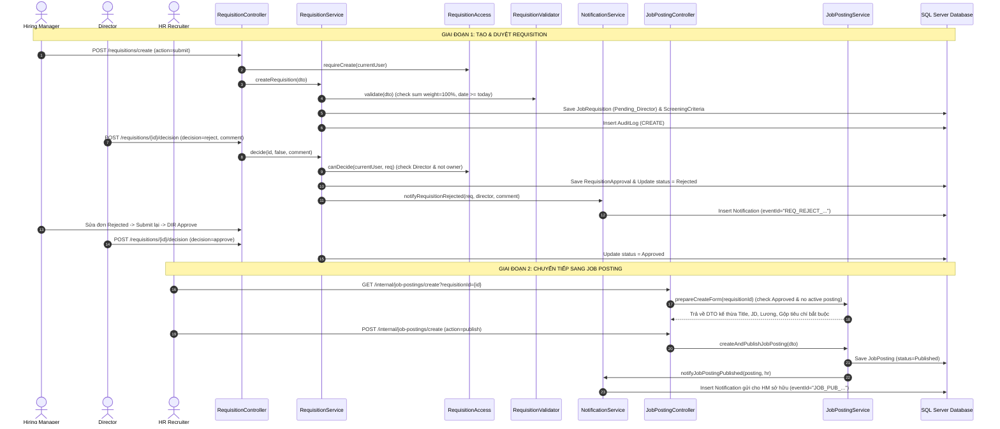

Dưới đây là bản tổng hợp toàn bộ **luồng code (End-to-End Code Flow)** và **danh sách các công việc/trách nhiệm (Checklist & Tasks)** của thành viên **Nguyễn Huy Hoàng (hoangnh)** trong dự án RMS, bao gồm 3 phân hệ chính: **Job Requisition**, **Job Posting (nội bộ)** và **Notification**.

---

## I. TỔNG QUAN PHẠM VI TRÁCH NHIỆM CỦA HOANGNH

Theo bảng phân công SRS và tài liệu `docs/members/hoangnh/checklist.md`:

| Phân hệ / Module | Mã SRS | Tên chức năng | Trách nhiệm chính |
| :--- | :--- | :--- | :--- |
| **Job Requisition** | **5.1.14** | Requisition List Screen | Danh sách, tìm kiếm, lọc, phân trang, phân quyền dữ liệu chặt chẽ theo Role |
| | **5.1.15** | Create / Update / Copy Requisition | Form tạo mới, lưu Draft, Submit duyệt, quản lý tiêu chí AI động, sao chép |
| | **5.1.16** | Requisition Details & Decision | Xem chi tiết, tiêu chí AI, Giám đốc Approve / Reject (bắt buộc lý do), Rút đơn (Withdraw), Xóa |
| **Internal Job Posting** | **5.1.18** | Internal Job Management | Quản lý tin tuyển dụng nội bộ cho HR/HM: Dashboard, tìm kiếm, lọc, chi tiết |
| | **5.1.19** | Post / Update Job Screen | Kế thừa dữ liệu từ Requisition đã Approved, tạo nháp, chỉnh sửa, đăng tuyển (Publish), tạm dừng (Pause), đóng đợt (Close) |
| **In-App Notification** | **Cross-cutting** | Notification System | Xây dựng hệ thống thông báo in-app dùng chung: bắn thông báo khi Director Reject, khi HR Publish tin, đánh dấu đã đọc, chống trùng lặp sự kiện |

> **Ranh giới phối hợp:** 
> * **HoangNH** phụ trách toàn bộ luồng quản trị nội bộ của tin tuyển dụng (`/internal/job-postings/**`), bảo mật, chuyển trạng thái và phát sinh thông báo.
> * Cổng hiển thị công khai ra bên ngoài cho ứng viên (`/jobs`, `/jobs/{id}`) do thành viên **DungLT** phụ trách (SRS 5.1.34, 5.1.35).

---

## II. FULL LUỒNG CODE CHI TIẾT (ARCHITECTURE & CODE FLOW)

Toàn bộ code được viết theo kiến trúc **Package-by-Feature**, tuân thủ nghiêm ngặt quy tắc tại [CLAUDE.md](CLAUDE.md).



---

### 1. Phân hệ Job Requisition

#### A. Tầng Phân quyền & Bảo vệ truy cập ([RequisitionAccess.java](file:///d:/FA%2026/SWP391/SWP-iter1/SWP_RMS_Group-2/src/main/java/com/group2/rms/requisition/service/RequisitionAccess.java))
* **`actor()`**: Lấy user từ `SecurityContextHolder`, kiểm tra trạng thái `Active` và Role hợp lệ.
* **`scope(currentUser)`** tại Service:
  * **Hiring Manager:** `WHERE hiringManagerId = currentUser.userId` (chỉ xem đơn của mình).
  * **Director:** `WHERE approvalStatus != 'Draft'` (không xem bản nháp của người khác).
  * **HR (P0 - Done):** `WHERE approvalStatus = 'Approved'` (**tuyệt đối chỉ xem đơn đã duyệt**, không lộ đơn Draft/Pending/Rejected).
* **`requireView()`**: HR cố tình gõ URL trực tiếp ID đơn Draft/Pending/Rejected sẽ bị chặn ngay bằng `AccessDeniedException` (HTTP 403 Forbidden).
* **`canEdit()`**: Chỉ người tạo hoặc Admin mới được sửa khi đơn ở trạng thái `Draft` hoặc `Rejected`.
* **`canDecide()`**: Chỉ Giám đốc (và **không phải người tạo đơn**) mới được duyệt/từ chối khi đơn ở `Pending_Director`.

#### B. Tầng Kiểm tra Tính hợp lệ ([RequisitionValidator.java](file:///d:/FA%2026/SWP391/SWP-iter1/SWP_RMS_Group-2/src/main/java/com/group2/rms/requisition/validator/RequisitionValidator.java))
* **Lưu nháp (`action = "draft"`):** Cho phép bỏ qua các trường bắt buộc; tự gán tiêu đề placeholder `"Untitled requisition"`; bỏ qua các dòng tiêu chí AI trống; cho phép trọng số linh hoạt để người dùng nhập dần.
* **Nộp duyệt (`action = "submit"`):**
  * Bắt buộc có tiêu đề thực tế (chặn `"Untitled requisition"`).
  * Số lượng tuyển dụng > 0; ngày bắt đầu dự kiến `>= LocalDate.now()`.
  * Mức lương: `minSalary <= maxSalary`.
  * **Bộ tiêu chí AI ([ScreeningCriteria](file:///d:/FA%2026/SWP391/SWP-iter1/SWP_RMS_Group-2/src/main/java/com/group2/rms/requisition/entity/ScreeningCriteria.java)):** Bắt buộc có ít nhất 1 tiêu chí; tên các tiêu chí không được trùng nhau; thuộc 4 nhóm (`Education, Experience, Skill, Knockout`); **tổng trọng số điểm weight bắt buộc đúng 100%**.

#### C. Tầng Nghiệp vụ cốt lõi ([RequisitionServiceImpl.java](file:///d:/FA%2026/SWP391/SWP-iter1/SWP_RMS_Group-2/src/main/java/com/group2/rms/requisition/service/RequisitionServiceImpl.java))
* **`createRequisition()`:**
  * HM chỉ được tạo cho phòng ban mình trực thuộc.
  * Kiểm tra chống tạo trùng lặp đơn Draft cho cùng một chức danh trong phòng ban (`existsDraftByTitleAndDepartment`).
  * Tự động tính đợt tuyển: Tìm đợt cao nhất của chức danh trong phòng ban để set `round = maxRound + 1`.
  * Lưu thực thể `JobRequisition` và các dòng `ScreeningCriteria`.
  * Ghi nhật ký vào bảng `AuditLog` (`action = CREATE`).
* **`updateRequisition()`:**
  * Sử dụng khóa bi quan (`findForUpdate(id)`) để chống xung đột ghi đồng thời.
  * Thuật toán **`synchronizeCriteria()`**: So sánh danh sách tiêu chí gửi lên với DB; xóa tiêu chí đã bị remove; đổi tên tạm thời qua UUID để tránh lỗi unique constraint của SQL Server; cập nhật thuộc tính hoặc thêm mới tiêu chí.
  * Tự động tạo `AuditLog` so sánh snapshot trước và sau, ghi rõ trường nào bị thay đổi theo định dạng: `Trường: Giá trị cũ → Giá trị mới`.
* **`decide(id, approved, comment)`:**
  * Giám đốc duyệt (`Approved`) hoặc từ chối (`Rejected`).
  * Khi từ chối, bắt buộc phải có `comment` (lý do).
  * Lưu vào bảng [RequisitionApproval](file:///d:/FA%2026/SWP391/SWP-iter1/SWP_RMS_Group-2/src/main/java/com/group2/rms/requisition/entity/RequisitionApproval.java).
  * **Kích hoạt Notification:** Nếu là Reject, gọi `notificationService.notifyRequisitionRejected()`.
* **`withdraw(id)`:** Hiring Manager rút đơn `Pending_Director` quay về `Draft` để tự sửa đổi.
* **`copy(id)`:** Nhân bản đơn cũ (chỉ cho phép sao chép đơn `Approved` hoặc `Rejected`); reset toàn bộ `criteriaId` về null; tự động gán `RecruitmentRound` kế tiếp.
* **`deleteRequisition(id)`:** Chỉ xóa được đơn `Draft`/`Rejected`; chặn xóa tuyệt đối nếu đơn đã được liên kết với `JobPosting`.

---

### 2. Phân hệ Job Posting (Tin tuyển dụng nội bộ)

Quản lý toàn bộ vòng đời tin đăng tại [JobPostingServiceImpl.java](file:///d:/FA%2026/SWP391/SWP-iter1/SWP_RMS_Group-2/src/main/java/com/group2/rms/jobposting/service/JobPostingServiceImpl.java) và [JobPostingController.java](file:///d:/FA%2026/SWP391/SWP-iter1/SWP_RMS_Group-2/src/main/java/com/group2/rms/jobposting/controller/JobPostingController.java):

#### A. Kế thừa dữ liệu thông minh (`prepareCreateForm`)
* HR bấm tạo tin từ Requisition ID -> Hệ thống kiểm tra: Requisition phải ở trạng thái `Approved` và **chưa có tin nào đang active/nháp** (`Draft, Published, Paused`).
* Tự động sinh DTO [JobPostingCreateRequest](file:///d:/FA%2026/SWP391/SWP-iter1/SWP_RMS_Group-2/src/main/java/com/group2/rms/jobposting/dto/JobPostingCreateRequest.java):
  * Điền sẵn: Tiêu đề, Phòng ban, Đợt tuyển, Hình thức, Địa điểm, Mô tả công việc.
  * Tự động format hiển thị lương: `"15,000,000 - 25,000,000 VNĐ"` hoặc `"Thỏa thuận"`.
  * **Tự động tổng hợp yêu cầu ứng viên:** Gộp `requirementDetails` của Requisition + tự động quét và format danh sách các tiêu chí bắt buộc:
    ```text
    Tiêu chí bắt buộc:
    - Bằng cấp: Đại học chuyên ngành CNTT
    - Kinh nghiệm: Tối thiểu 2 năm Java Spring Boot
    ```

#### B. Vòng đời trạng thái tin đăng (State Transitions)
* **Tạo nháp (`createJobPosting`)**: Lưu với trạng thái `Draft`, không hiển thị ra ngoài cổng tuyển dụng công khai.
* **Đăng tin (`createAndPublish` / `publishJobPosting`)**:
  * Kiểm tra nội dung tối thiểu (Tiêu đề, mô tả, yêu cầu) qua [JobPostingValidator.java](file:///d:/FA%2026/SWP391/SWP-iter1/SWP_RMS_Group-2/src/main/java/com/group2/rms/jobposting/validator/JobPostingValidator.java).
  * Hạn nộp hồ sơ (`ApplicationDeadline`) phải sau thời điểm hiện tại (trừ chế độ tuyển liên tục).
  * Chuyển trạng thái `Published`, gán `postingDate = LocalDateTime.now()`.
  * **Kích hoạt Notification:** Gọi `notificationService.notifyJobPostingPublished()` gửi thông báo cho Hiring Manager sở hữu đơn nguồn.
* **Tạm dừng (`pauseJobPosting`)**: Chuyển trạng thái sang `Paused`, tin bị ẩn khỏi Career Portal để ngừng nhận thêm CV.
* **Đóng đợt tuyển (`closeJobPosting`)**:
  * Bàn giao sang `TalentPoolService.closeJob(id)`.
  * Kiểm tra an toàn: Chặn đóng nếu còn Offer chưa kết thúc.
  * Đổi trạng thái sang `Closed` (bất biến, không thể sửa/mở lại).
  * Quét dọn các hồ sơ chưa xử lý: chuyển sang `Rejected` (lý do `PostingClosed`), tự động hủy lịch phỏng vấn chưa diễn ra, kích hoạt gửi email đóng tuyển dụng.

---

### 3. Phân hệ In-App Notification (Thông báo nội bộ)

Được thiết kế độc lập, không phụ thuộc vòng tại package `com.group2.rms.notification`:

#### A. Cấu trúc thực thể ([Notification.java](file:///d:/FA%2026/SWP391/SWP-iter1/SWP_RMS_Group-2/src/main/java/com/group2/rms/notification/Notification.java))
* Gồm: `NotificationId`, `Recipient` (User), `Title`, `Content`, `EventType`, `ReferenceId`, `LinkUrl`, `IsRead`, `CreatedAt`.
* **Cơ chế Idempotent (`EventId` unique):** Chống tạo trùng lặp thông báo khi người dùng click đúp hoặc retry request:
  * Ví dụ reject: `eventId = "REQ_REJECT_" + reqId + "_" + decidedTimestamp`.
  * Ví dụ publish: `eventId = "JOB_PUB_" + postingId + "_" + postingTimestamp`.

#### B. Luồng thông báo
1. **Thông báo từ chối Requisition:**
   * Khi Director Reject, hệ thống tự động soạn nội dung: *"Yêu cầu tuyển dụng [Title] (Mã: REQ-xx) đã bị Giám đốc [Tên] từ chối lúc [Giờ]. Lý do: [Comment]. Vui lòng chỉnh sửa lại..."*.
   * Gắn link điều hướng: `/requisitions/{id}`.
2. **Thông báo đăng tin Job Posting:**
   * Khi HR Publish, gửi thông báo cho HM: *"Tin tuyển dụng cho vị trí [Title] đã được HR [Tên] đăng tuyển thành công..."*.
   * Gắn link điều hướng: `/internal/job-postings/{id}`.
3. **Quản lý giao diện thông báo ([NotificationController.java](file:///d:/FA%2026/SWP391/SWP-iter1/SWP_RMS_Group-2/src/main/java/com/group2/rms/notification/NotificationController.java)):**
   * `GET /notifications`: Xem danh sách phân trang, badge "New", thời gian.
   * `POST /notifications/{id}/read`: Đánh dấu đã đọc và chuyển hướng đến trang liên quan.
   * `POST /notifications/read-all`: Đánh dấu đã đọc tất cả.
   * `GET /notifications/unread-count`: API trả về số lượng thông báo chưa đọc cho icon chuông thông báo trên Header/Sidebar.

---

## III. BẢNG CHECKLIST CÁC CÔNG VIỆC PHẢI LÀM (TASKS COMPLETED & HANDOFF)

Dưới đây là bảng tổng hợp các đầu mục công việc mà Hoàng (hoangnh) phụ trách trong toàn bộ Iteration 1 và Iteration 2:

### 1. Phân hệ Job Requisition (Hoàn tất 100%)
- [x] **Cơ sở dữ liệu & Entity:** Thiết kế và ánh xạ JPA cho `JobRequisition`, `ScreeningCriteria`, `RequisitionApproval`, `AuditLog`.
- [x] **Bộ lọc & Phân trang:** Xây dựng `JobRequisitionRepository` kết hợp `JpaSpecificationExecutor` hỗ trợ tìm kiếm theo từ khóa, lọc theo phòng ban, chức danh, hình thức, trạng thái và sắp xếp đa chiều.
- [x] **Quy chuẩn Validation Server-side:** Hoàn thiện `RequisitionValidator` phân biệt rõ ràng 2 luồng: Lưu nháp (`draft`) và Nộp duyệt (`submit` - kiểm tra tổng trọng số AI đúng 100%).
- [x] **Phân quyền P0:** Khóa chặt phạm vi truy cập: HR **chỉ được xem đơn `Approved`** (ở cả danh sách, đếm số lượng, phân trang và chặn 403 Forbidden khi gõ trực tiếp URL).
- [x] **Các thao tác nghiệp vụ:** Hoàn thiện Create, Update, Submit, Withdraw, Approve, Reject (kèm phản hồi bắt buộc), Copy (reset ID tiêu chí, tăng đợt), Delete (chặn xóa nếu đã có Job Posting).
- [x] **Giao diện người dùng:** 
  - `requisitions/list.html`: Bảng danh sách, phân trang, bộ lọc, menu thao tác floating dropdown không bị che khuất.
  - `requisitions/form.html`: Form nhập liệu đầy đủ trường, hỗ trợ JS thêm/xóa/đánh số thứ tự dòng tiêu chí AI động.
  - `requisitions/detail.html`: Xem chi tiết thông số, danh sách tiêu chí AI, lịch sử duyệt và modal duyệt/từ chối của Giám đốc.

### 2. Phân hệ Job Posting nội bộ (Hoàn tất 100%)
- [x] **Đường dẫn nội bộ riêng:** Tách bạch route quản trị nội bộ `/internal/job-postings/**` với route cổng thông tin công khai `/jobs`.
- [x] **HR Dashboard:** Màn hình `/internal/job-postings/dashboard` hiển thị thống kê số tin Active, Draft, Closed, biểu đồ phòng ban và danh sách các Requisition đã Approved đang chờ tạo tin.
- [x] **Tự động kế thừa dữ liệu:** Tự động điền dữ liệu từ Requisition sang Job Posting form, tự format dải lương và tổng hợp tiêu chí sàng lọc bắt buộc vào phần yêu cầu ứng viên.
- [x] **Ràng buộc duy nhất:** Chặn không cho tạo nhiều hơn 1 tin active/nháp cho cùng 1 Requisition nguồn.
- [x] **Quản trị vòng đời tin:** Xây dựng đầy đủ các nút bấm và nghiệp vụ: Lưu nháp (Draft), Đăng tuyển (Publish), Tạm dừng (Pause), Đóng đợt tuyển (Close - đồng bộ dọn dẹp Talent Pool), Xóa tin nháp.
- [x] **Giao diện quản trị:** `job-postings/list.html`, `job-postings/create.html`, `job-postings/detail.html`, `job-postings/dashboard.html` đồng bộ chuẩn CSS RMS (theme xanh lá/accent, font Inter, 100% tiếng Việt).

### 3. Phân hệ Notification (Hoàn tất 100%)
- [x] **Khởi tạo module Notification:** Thiết kế thực thể `Notification`, migration script SQL `005_notification.sql`.
- [x] **Tích hợp tự động vào luồng Requisition:** Director Reject đơn -> tự động sinh thông báo in-app gửi riêng cho Hiring Manager sở hữu đơn kèm feedback.
- [x] **Tích hợp tự động vào luồng Job Posting:** HR Publish tin -> tự động sinh thông báo gửi cho Hiring Manager để biết vị trí của phòng ban mình đã lên sàn.
- [x] **Chống tạo trùng lặp:** Áp dụng `eventId` duy nhất chống nhân bản thông báo khi retry hoặc gửi lại request.
- [x] **Giao diện & API:** Trang `/notifications` xem danh sách, nút đánh dấu đã đọc, API `/unread-count` phục vụ polling số lượng thông báo mới.

### 4. Hệ thống Kiểm thử (Testing Suites)
- [x] **Stage 1 - Validator Test (`RequisitionValidatorTests.java`):** Bao phủ 20 nhóm quy tắc nghiệp vụ (`VAL-001` đến `VAL-020`).
- [x] **Stage 2 - Service Unit Test (`JobRequisitionServiceTest.java`, `JobPostingServiceTest`):** Mockito test kiểm tra logic nghiệp vụ, gán giá trị mặc định, lọc tiêu chí rỗng, kiểm tra quyền.
- [x] **Stage 3 - Controller / MVC Test (`JobRequisitionControllerTests.java`):** MockMvc test kiểm tra HTTP Status, redirect, flash message, CSRF token, chặn quyền Candidate.
- [x] **Stage 4 - Integration Test (`RequisitionIntegrationTest.java`):** Kiểm thử tích hợp thật với Database SQL Server trong transaction rollback.

---

## IV. TÓM TẮT ĐIỂM CẦN NẮM VỮNG KHI TRÌNH BÀY / BÁO CÁO

Khi báo cáo hoặc giải trình code với Mentor / Giảng viên:
1. **Về tính toàn vẹn dữ liệu (Data Integrity):** Nhấn mạnh việc sử dụng **khóa bi quan (`findForUpdate`)** khi chỉnh sửa/duyệt đơn để tránh Race Condition; giải thích thuật toán **`synchronizeCriteria`** đổi tên tạm thời qua UUID để không dính lỗi Unique Constraint của SQL Server.
2. **Về phân quyền (Security):** Nhấn mạnh điểm chốt cốt lõi **"HR chỉ được xem Requisition có trạng thái Approved"** đã được kiểm soát tận gốc từ câu lệnh Query Specification ở Database cho đến tầng Controller/Service, không chỉ đơn thuần là ẩn nút trên giao diện HTML.
3. **Về trải nghiệm người dùng (UX):** Nêu bật tính năng **Lưu nháp (Save Draft)** và **Sao chép (Copy)** giúp Hiring Manager không phải nhập lại từ đầu; cùng hệ thống **Thông báo In-App một chạm** dẫn thẳng về trang chỉnh sửa ngay khi bị từ chối.