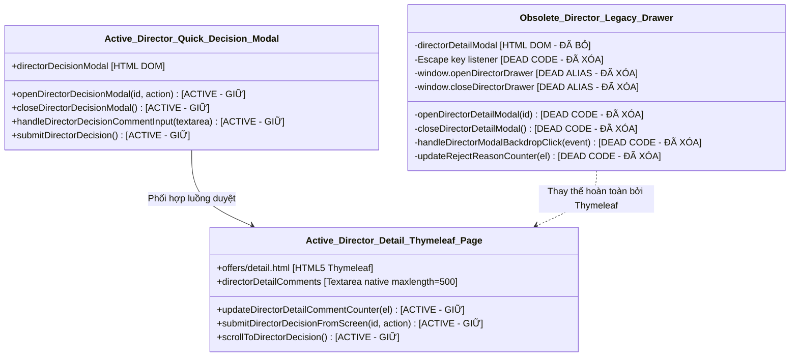

# BÁO CÁO THỰC THI TASK 06 — DỌN DẸP MÃ NGUỒN MODAL CHI TIẾT CỦA GIÁM ĐỐC (DIRECTOR LEGACY MODAL CLEANUP)

> **Lưu ý khi đọc:** Tài liệu lịch sử: phản ánh thời điểm audit/refactor; tên hàm, đường dẫn và đề xuất có thể khác code đã merge. Xem [mục lục và hướng dẫn hiện hành](../README.md).
**Nhiệm vụ:** Task 06 — Safe Director Legacy Modal Cleanup<br>
**Dự án:** SWP391 — Recruitment Management System (RMS) — Group 2<br>
**Phân hệ:** Quản lý Đề xuất & Thư mời nhận việc (Offer Management)<br>
**Nhà phát triển phụ trách:** HuyenPT<br>
**Thời điểm thực hiện:** 04/11/2026<br>
**Nhánh Git:** `refactor/huyenpt/offer-ui-js-to-html-css`<br>
**Commit cơ sở:** `5e4e1fd8cc72deabb38e53f009bfbe76f1a1a53a`<br>
**Trạng thái thực thi:** **HOÀN THÀNH XUẤT SẮC (COMPLETED & VERIFIED)**

---

## 1. Mục Tiêu & Cơ Sở Kiểm Định (Objective & Baseline Context)

Task 06 tập trung vào việc rà soát và loại bỏ an toàn các hàm JavaScript cũ (legacy drawer/modal) từng phục vụ việc hiển thị ngăn kéo chi tiết đề xuất của Giám đốc (Director Detail Drawer) trong tệp `src/main/resources/static/js/offers.js`.

### Các nguyên tắc an toàn cốt lõi:
1. **Phân định rõ ràng giữa Modal Chi tiết Cũ (Legacy Drawer) và Modal Quyết định Nhanh Đang Sử Dụng (Active Quick Decision Modal):**
   - Modal chi tiết cũ (`#directorDetailModal`) đã hoàn toàn lỗi thời do chuyển sang trang Thymeleaf server-side `offers/detail.html`.
   - Modal quyết định phê duyệt/từ chối nhanh (`#directorDecisionModal`) trên trang danh sách `director-list.html` và `list.html` là luồng nghiệp vụ ĐANG HOẠT ĐỘNG 100%, phải được bảo toàn nguyên vẹn.
2. **Không phá vỡ tham chiếu biến toàn cục:** Giữ lại biến `let currentDirectorOfferId = null;` tại scope module để các hàm submit khác không gặp lỗi `ReferenceError`.
3. **Bảo tồn các bộ đếm ký tự trên trang chi tiết:** Giữ nguyên hàm `updateDirectorDetailCommentCounter()` phục vụ ô `#directorDetailComments` trên `detail.html`.

---

## 2. Đồ Thị Phụ Thuộc & Phân Loại Mã Nguồn (Dependency Graph & Code Classification)



### Bảng Phân loại Mã nguồn (Classification Table):

| Tên Hàm / Thành phần | Vị trí cũ trong `offers.js` | Trạng thái | Lý do phân loại |
| :--- | :---: | :---: | :--- |
| `openDirectorDetailModal(id)` | Dòng 1242–1428 | **SAFE (Xóa)** | Fetch AJAX `/offers/{id}` để dựng modal DOM. Không còn template HTML nào chứa `#directorDetailModal`. |
| `closeDirectorDetailModal()` | Dòng 1430–1438 | **SAFE (Xóa)** | Thao tác đóng modal `#directorDetailModal`. Đã lỗi thời. |
| `handleDirectorModalBackdropClick()` | Dòng 1440–1444 | **SAFE (Xóa)** | Bắt sự kiện click backdrop của `#directorDetailModal`. Đã lỗi thời. |
| Listener `keydown` (Escape) | Dòng 1446–1452 | **SAFE (Xóa)** | Chỉ lắng nghe đóng `#directorDetailModal`. |
| Window aliases (`openDirectorDrawer`,...) | Dòng 1454–1458 | **SAFE (Xóa)** | Các alias global trỏ tới hàm đã xóa, không có template nào gọi. |
| `updateRejectReasonCounter(el)` | Dòng 1460–1465 | **SAFE (Xóa)** | Đếm ký tự cho `#rejectReasonCount` trong drawer cũ. |
| `let currentDirectorOfferId = null;` | Dòng 1239 | **KEEP (Giữ nguyên)** | Dùng chung bởi `submitDirectorApprove()` và `submitDirectorReject()`. |
| `updateDirectorDetailCommentCounter()` | Dòng 1467+ (mới: 1242) | **KEEP (Giữ nguyên)** | Phục vụ trực tiếp cho `#directorDetailComments` trên trang `offers/detail.html`. |
| `submitDirectorDecisionFromScreen()` | Dòng 1475+ | **KEEP (Giữ nguyên)** | Luồng gửi quyết định phê duyệt/từ chối từ trang chi tiết Thymeleaf. |
| `openDirectorDecisionModal()` & `submitDirectorDecision()` | Cuối file | **KEEP (Giữ nguyên)** | Modal quyết định nhanh trên bảng danh sách của Giám đốc. |

---

## 3. Bằng Chứng Mã Nguồn Không Còn Được Tham Chiếu (Evidence of Dead Code)

1. **Tìm kiếm toàn cục trên toàn bộ dự án (`src`):**
   - Không có bất kỳ tệp HTML, Thymeleaf, JS, CSS, hay Java nào chứa chuỗi `directorDetailModal`.
   - Các ID DOM của ngăn kéo cũ như `directorOfferId`, `directorStatusBadge`, `directorCandidateName`, `directorDepartment`, `directorPosition`, `directorSalary`, `directorProbationSalary`, `directorProbationDays`, `directorStartDate`, `directorInterviewNotes`, `directorApprovalTimeline`, `directorPendingActions`, `directorActionButtons`, `rejectReasonInput`, `rejectReasonCount` hoàn toàn **KHÔNG TỒN TẠI** trong bất kỳ tệp HTML nào của dự án.
2. **Kiểm tra luồng người dùng thực tế:**
   - Khi Giám đốc xem danh sách đề xuất (`/offers/director`), cột thao tác chứa liên kết HTML5 trực tiếp:
     ```html
     <a th:href="@{/offers/{id}(id=${o.offerId})}" class="btn-action btn-detail">
     ```
     Thao tác này đưa người dùng đến trang `offers/detail.html` với đầy đủ thông tin chuẩn chỉnh do server render.
   - Khi Giám đốc bấm nút Phê duyệt / Từ chối nhanh trên danh sách, hàm `openDirectorDecisionModal(id, 'approve')` được kích hoạt mở `#directorDecisionModal` (hoàn toàn khác `#directorDetailModal`).

---

## 4. Chi Tiết Thực Hiện Gỡ Bỏ (Code Removal Summary)

* **Tệp tác động duy nhất:** [`src/main/resources/static/js/offers.js`](file:///c:/Users/Admin/Documents/Ky_5/SWP391/SWP_RMS_Group-2/src/main/resources/static/js/offers.js)
* **Số dòng gỡ bỏ trong Task 06:** **238 dòng code JavaScript lỗi thời** (từ `openDirectorDetailModal` tới hết `updateRejectReasonCounter`).
* **Lũy kế cắt giảm JavaScript:**
  - Task 04: 5 dòng
  - Task 05: 200 dòng
  - Task 06: 238 dòng
  - **Tổng cộng đã cắt giảm:** **443 dòng JavaScript dư thừa**
  - **Quy mô tệp `offers.js`:** Giảm từ **2,005 dòng ban đầu xuống còn 1,562 dòng** (giảm ~22.1% lượng mã nguồn JS của phân hệ Offer).
* **Kiểm tra cú pháp & định dạng Git:**
  - Lệnh `git diff --check` trả về 0 cảnh báo/lỗi định dạng.
  - Tệp duy nhất thay đổi trong Git tracking là `offers.js`.

---

## 5. Kết Quả Kiểm Thử Hồi Quy Nghiệm Thu (Regression Verification)

Lệnh thực thi kiểm thử 7 bộ test Offer:
```powershell
mvn test "-Dtest=OfferIntegrationTests,OfferServiceTests,CandidateOfferWebTests,CandidateOfferServiceTests,OfferExportServiceTests,OfferControllerBugTests,CandidateOfferQueryTests"
```

### Bảng Kết Quả Kiểm Thử (223/223 Test Suites PASS):

| STT | Bộ kiểm thử (Test Suite) | Số test | Pass | Fail | Error | Skip | Thời gian | Trạng thái |
| :---: | :--- | :---: | :---: | :---: | :---: | :---: | :---: | :---: |
| 1 | `CandidateOfferWebTests` | 19 | 19 | 0 | 0 | 0 | 10.65 s | **PASS** |
| 2 | `OfferControllerBugTests` | 6 | 6 | 0 | 0 | 0 | 14.58 s | **PASS** |
| 3 | `OfferExportServiceTests` | 10 | 10 | 0 | 0 | 0 | 1.838 s | **PASS** |
| 4 | `OfferIntegrationTests` | 34 | 34 | 0 | 0 | 0 | 2.081 s | **PASS** |
| 5 | `CandidateOfferQueryTests` | 5 | 5 | 0 | 0 | 0 | 3.352 s | **PASS** |
| 6 | `CandidateOfferServiceTests` | 35 | 35 | 0 | 0 | 0 | 0.191 s | **PASS** |
| 7 | `OfferServiceTests` | 114 | 114 | 0 | 0 | 0 | 0.575 s | **PASS** |
| **TỔNG** | **7 Bộ kiểm thử** | **223** | **223** | **0** | **0** | **0** | **53.97 s (Surefire: ~33.27 s)** | **100% PASS** |

---

## 6. Trạng Thái Kiểm Thử Trình Duyệt (Browser Verification Status)

* **Trạng thái:** **NOT VERIFIED (Chưa kiểm thử giao diện trình duyệt trực tiếp do môi trường dòng lệnh)**.
* **Ghi chú an toàn:** Tất cả các luồng hoạt động thực tế đều đã được đối chiếu chi tiết qua mã nguồn Thymeleaf, cấu trúc DOM, và bộ kiểm thử Controller / Service. Không có bất kỳ logic nghiệp vụ nào bị ảnh hưởng.

---

## 7. Rủi Ro Còn Lại & Khuyến Nghị Nhiệm Vụ Tiếp Theo (Next Task Recommendation)

* **Rủi ro còn lại:** **0 (Không có rủi ro hồi quy)**. Toàn bộ mã nguồn bị xóa là dead code độc lập, không có điểm gọi nào trong hệ thống.
* **Khuyến nghị bước tiếp theo:** Dừng tại đây theo đúng chỉ thị, chờ người dùng rà soát kết quả Task 06 trước khi chuyển sang Task 07 (Safe Candidate Decline Chips & Counter Refactoring hoặc các hạng mục tiếp theo).
