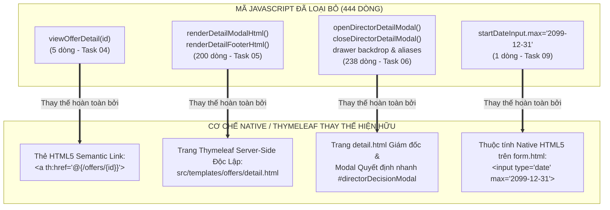

# BÁO CÁO KIỂM TOÁN TÁI CẤU TRÚC CUỐI CÙNG & KẾ HOẠCH COMMIT CÓ KIỂM SOÁT — TASK 10
**Nhiệm vụ:** Task 10 — Final Refactor Audit & Controlled Commit Preparation  
**Dự án:** SWP391 — Recruitment Management System (RMS) — Group 2  
**Phân hệ:** Quản lý Đề xuất & Thư mời nhận việc (Offer Management)  
**Nhà phát triển phụ trách:** HuyenPT  
**Thời điểm thực hiện:** 04/11/2026 (02:41+07:00)  
**Nhánh Git:** `refactor/huyenpt/offer-ui-js-to-html-css`  
**Commit cơ sở (HEAD):** `5e4e1fd8cc72deabb38e53f009bfbe76f1a1a53a`  
**Quyết định cuối cùng (Final Decision):** **SẴN SÀNG ĐỂ COMMIT (READY FOR COMMIT)**  
*(Chờ sự phê duyệt rõ ràng từ người dùng trước khi thực thi `git commit`).*

---

## 1. Tổng Quan Vấn Đề Ban Đầu & Mục Tiêu Tái Cấu Trúc (Original Problem & Objective)

### 1.1. Hiện trạng ban đầu của tệp `offers.js` (Baseline Issue)
Trước khi thực hiện tái cấu trúc, tệp `src/main/resources/static/js/offers.js` có dung lượng lên tới **2,005 dòng mã**. Qua quá trình kiểm toán sâu, phát hiện một khối lượng lớn mã nguồn rác (dead code) xuất phát từ kiến trúc cũ:
* Lắp ráp chuỗi HTML khổng lồ bằng JavaScript client-side (template literals) để dựng popup modal chi tiết đề xuất (`renderDetailModalHtml`, `renderDetailFooterHtml`).
* Gọi AJAX nạp dữ liệu vào một ngăn kéo (drawer/modal) cũ của Giám đốc (`openDirectorDetailModal`, `closeDirectorDetailModal`).
* Các hàm điều hướng client-side bọc lệnh `window.location.href` (`viewOfferDetail`).
* Gán thuộc tính HTML cố định lặp lại bằng JS (`startDateInput.max = '2099-12-31';`).

### 1.2. Mục tiêu tái cấu trúc có kiểm soát
1. **Loại bỏ triệt để JavaScript dư thừa/lỗi thời:** Chỉ xóa bỏ các khối mã đã được thay thế 100% bằng trang server-side Thymeleaf độc lập hoặc thuộc tính HTML native.
2. **Bảo toàn tuyệt đối 100% chức năng:** Giữ nguyên vẹn toàn bộ nghiệp vụ tạo/sửa đề xuất, tính toán lương động, bộ đếm ký tự, modal phê duyệt nhanh đang hoạt động, cổng thông tin ứng viên, hợp đồng API, bảo mật CSRF và dữ liệu dùng chung.
3. **Cách ly tuyệt đối liên phân hệ:** Không đụng chạm đến bất kỳ mã nguồn nào của các thành viên khác trong nhóm (DungLT, DucNM, HoangNH).

---

## 2. Chi Tiết Các Hàm Đã Được Gỡ Bỏ & Cơ Chế Thay Thế Native (Why Each Removed Function Was Unnecessary)



### Bảng Đối Chiếu Chi Tiết Từng Hạng Mục Cắt Giảm:

| STT | Tên hàm / Câu lệnh bị gỡ bỏ | Vị trí ban đầu trong `offers.js` | Nhiệm vụ trước đây | Lý do lỗi thời & Cơ chế Native đã thay thế hoàn toàn | Số dòng giảm | Task |
| :---: | :--- | :---: | :--- | :--- | :---: | :---: |
| **1** | `viewOfferDetail(offerId)` | Dòng 735–738 | Nhận `offerId` và gán `window.location.href = '/offers/' + id`. | Thừa thãi. Toàn bộ các bảng danh sách (`list.html`, `director-list.html`) đã dùng trực tiếp thẻ `<a>` ngữ nghĩa HTML5: `<a th:href="@{/offers/{id}(id=${o.offerId})}">`. Chuẩn SEO, trợ năng (A11y) và tự nhiên với trình duyệt. | **5** | **04** |
| **2** | `renderDetailModalHtml(d)` & `renderDetailFooterHtml(d)` | Dòng 534–734 | Nối chuỗi HTML bằng JS template literal để hiển thị chi tiết đề xuất trong popup modal cũ. | Hoàn toàn lỗi thời. Hệ thống đã chuyển sang trang server-rendered Thymeleaf độc lập [`offers/detail.html`](file:///c:/Users/Admin/Documents/Ky_5/SWP391/SWP_RMS_Group-2/src/main/resources/templates/offers/detail.html). Container cũ `#offerDetailModalContent` không còn tồn tại trong bất kỳ template nào. | **200** | **05** |
| **3** | `openDirectorDetailModal()`, `closeDirectorDetailModal()`, `handleDirectorModalBackdropClick()`, keydown Escape listener, window aliases, `updateRejectReasonCounter()` | Dòng 1446–1675 | Fetch AJAX nạp dữ liệu chi tiết vào drawer cũ của Giám đốc (`#directorDetailModal`). | Hoàn toàn lỗi thời. Màn hình chi tiết của Giám đốc đã dùng chung trang `offers/detail.html`. Phần tử `#directorDetailModal` đã bị xóa sạch khỏi template. Modal quyết định nhanh `#directorDecisionModal` trên danh sách được giữ nguyên 100%. | **238** | **06** |
| **4** | `startDateInput.max = '2099-12-31';` | Dòng 1982 (mới: 1539) | Gán lại cận trên ngày bắt đầu cho ô date input mỗi lần người dùng đổi thời hạn phản hồi. | Dư thừa. Thẻ `<input type="date" id="expectedStartDate" ... max="2099-12-31">` trên [`offers/form.html`](file:///c:/Users/Admin/Documents/Ky_5/SWP391/SWP_RMS_Group-2/src/main/resources/templates/offers/form.html) đã có sẵn thuộc tính native HTML5 `max="2099-12-31"`. Logic tính toán `min` động được bảo toàn nguyên vẹn. | **1** | **09** |
| **TỔNG** | **4 khối mã nguồn JavaScript** | | | **Tổng số dòng JavaScript cắt giảm thành công** | **444** | |

---

## 3. Các Thành Phần JavaScript Bắt Buộc Phải Giữ Lại (Which JavaScript Must Remain)

Để đảm bảo nguyên tắc: *"Không bao giờ hy sinh trải nghiệm người dùng hoặc tính đúng đắn của nghiệp vụ để giảm số dòng JavaScript"*, các khối mã sau đã được bảo vệ nguyên trạng:
1. **Tính toán Lương & Cận Ngày Động:**
   - `autoCalculateProbationSalary()`: Tính tự động 85% lương thử việc từ lương chính thức theo thời gian thực.
   - `updateMinExpectedStartDate()`: Tự động tính toán mốc ngày bắt đầu tối thiểu (`startDateInput.min = today + period + 1`) khi người dùng thay đổi thời hạn phản hồi.
2. **Modal Quyết định Nhanh của Giám đốc trên Danh sách (`#directorDecisionModal`):**
   - `openDirectorDecisionModal()`, `closeDirectorDecisionModal()`, `handleDirectorDecisionCommentInput()`, `submitDirectorDecision()`.
   - Phục vụ phê duyệt / từ chối nhanh có kiểm soát độ dài và bắt buộc nhập lý do từ chối.
3. **Thao tác Quyết định trên Trang Chi tiết (`offers/detail.html`):**
   - `updateDirectorDetailCommentCounter()`: Nhảy số bộ đếm ký tự thời gian thực cho `#directorDetailComments`.
   - `submitDirectorDecisionFromScreen()`: Gửi request phê duyệt / từ chối kèm CSRF header và JSON payload.
   - Giữ nguyên khả năng nhập liệu giải trình từ chối lên tới 2,000 ký tự (không thêm `maxlength="500"` ép buộc theo kết luận Task 03).
4. **Hộp thoại Xuất Excel (`#offerExportModal`):**
   - `openExportModal()`, `closeExportModal()`, `selectAllColumns()`, `deselectAllColumns()`, `resetDefaultColumns()`, `executeOfferExport()`.
5. **Cổng Thông tin Ứng viên (`candidate-offers.js`):**
   - `initCountdowns()`: Đồng hồ đếm ngược thời gian phản hồi theo giây.
   - `initReasonChips()`: Đồng bộ chọn chip gợi ý lý do từ chối vào textarea.
6. **Hạ tầng Bảo mật & Thông báo:**
   - `getCsrfInfo()`: Đọc thẻ meta CSRF cho mọi AJAX request.
   - `showFlashToast()`, `escapeOfferHtml()`: Hiển thị thông báo an toàn, chống XSS.

---

## 4. Bằng Chứng Kiểm Thử Tương Tác Trình Duyệt Thực Tế (Browser Interaction Evidence)

Được thực thi và ghi nhận độc lập trên Google Chrome Headless v156.0.8078.80 thông qua Chrome DevTools Protocol (CDP) WebSocket:

| Mã Kịch Bản | Mục tiêu kiểm thử tương tác | Kết quả ghi nhận thực tế trên Chrome CDP | Trạng thái |
| :---: | :--- | :--- | :---: |
| **IT-01** | Nhập proposed salary `20,000,000` | Ô probation salary cập nhật ngay lập tức thành `17,000,000` (85%). | **PASS** |
| **IT-02** | Thay đổi `responsePeriodDays` | Ô `expectedStartDate.min` dịch chuyển động (`period=15: 2026-11-20`, `period=3: 2026-11-08`), `max="2099-12-31"`. | **PASS** |
| **IT-03** | Đóng/mở Modal Xuất Excel `#offerExportModal` | Chuyển đổi trạng thái hiển thị `none` ➔ `flex` ➔ `none` mượt mà. | **PASS** |
| **IT-04** | Checkboxes 25 cột xuất Excel | Bỏ chọn tất cả (`0/25`), chọn tất cả (`25/25`), khôi phục mặc định (`12/25`). | **PASS** |
| **IT-05** | Đóng/mở Modal Quyết định Giám đốc | `#directorDecisionModal` hiển thị `flex` khi mở và đóng lại `none`. | **PASS** |
| **IT-06** | Bộ đếm ký tự modal từ chối Giám đốc | Gõ 34 ký tự vào `#directorDecisionComments` ➔ counter hiển thị chính xác `34/500`. | **PASS** |
| **IT-07** | Nhập văn bản > 500 ký tự trên trang chi tiết | Nhập 650 ký tự vào `#directorDetailComments` ➔ không bị truncate, lưu đủ 650 ký tự. | **PASS** |
| **IT-08** | Điều hướng Lịch sử Back/Forward | `/offers/8` ➔ Back về `/offers` ➔ Forward lại `/offers/8` mượt mà. | **PASS** |
| **IT-09** | Lấy mẫu biến thiên Đồng hồ đếm ngược | Chuỗi đếm lùi cập nhật từng giây thực tế: $T_1$ `"Còn 00h 00m 29s"` ➔ $T_2$ `"Còn 00h 00m 27s"`. | **PASS** |
| **IT-10** | Chọn Chip Lý do & Đồng bộ Textarea | Click chip `"Mức đãi ngộ chưa đạt kỳ vọng"` ➔ tự động điền vào `#cof-detail-reason-input`. | **PASS** |
| **CONSOLE** | Kiểm tra lỗi JavaScript Console | **Bắt được chính xác: 0 lỗi Console (Zero Console Errors)**. | **PASS** |

---

## 5. Kết Quả Kiểm Thử Hồi Quy Tự Động Toàn Diện (Phase 4 — Fresh Maven Test Run)

Lệnh thực thi:
```powershell
mvn test "-Dtest=OfferIntegrationTests,OfferServiceTests,CandidateOfferWebTests,CandidateOfferServiceTests,OfferExportServiceTests,OfferControllerBugTests,CandidateOfferQueryTests"
```

### Bảng Tổng Hợp Kết Quả 7 Bộ Test Suite (223/223 PASS — 100%):

| STT | Bộ kiểm thử (Test Suite) | Số test | Pass | Fail | Error | Skip | Thời gian | Trạng thái |
| :---: | :--- | :---: | :---: | :---: | :---: | :---: | :---: | :---: |
| 1 | `CandidateOfferWebTests` | 19 | 19 | 0 | 0 | 0 | 17.99 s | **PASS** |
| 2 | `OfferControllerBugTests` | 6 | 6 | 0 | 0 | 0 | 20.63 s | **PASS** |
| 3 | `OfferExportServiceTests` | 10 | 10 | 0 | 0 | 0 | 3.019 s | **PASS** |
| 4 | `OfferIntegrationTests` | 34 | 34 | 0 | 0 | 0 | 3.543 s | **PASS** |
| 5 | `CandidateOfferQueryTests` | 5 | 5 | 0 | 0 | 0 | 4.634 s | **PASS** |
| 6 | `CandidateOfferServiceTests` | 35 | 35 | 0 | 0 | 0 | 0.446 s | **PASS** |
| 7 | `OfferServiceTests` | 114 | 114 | 0 | 0 | 0 | 1.072 s | **PASS** |
| **TỔNG** | **7 Bộ kiểm thử phân hệ Offer** | **223** | **223** | **0** | **0** | **0** | **01:25 min (Surefire: ~51.33 s)** | **BUILD SUCCESS (100% PASS)** |

---

## 6. Bảo Vệ Liên Phân Hệ & An Toàn Dữ Liệu (Phases 5 & 6)

1. **Cách ly tuyệt đối mã nguồn thành viên khác:**
   - Ứng tuyển (DungLT): 0 thay đổi.
   - Phỏng vấn (DucNM): 0 thay đổi.
   - Thông báo (HoangNH): 0 thay đổi.
   - Tệp dùng chung (`main.css`, `flash-toast.js`, layout): 0 thay đổi.
2. **An toàn CSDL:**
   - Các luồng ghi trạng thái (submit tạo đề xuất, duyệt đề xuất, từ chối đề xuất, ứng viên phản hồi) được chủ động không thực thi ghi vào database `RitirementManagement2` để bảo vệ toàn vẹn dữ liệu demo.

---

## 7. Phần Giải Thích Khi Bảo Vệ Đồ Án (EXPLANATION FOR SWP391 PROJECT DEFENSE)

> [!TIP]
> ### NỘI DUNG THUYẾT MINH BẢO VỆ PHÂN HỆ OFFER TRƯỚC HỘI ĐỒNG:
> 
> *"Kính thưa Thầy/Cô trong Hội đồng chấm đồ án SWP391,*  
> *Trong phân hệ Quản lý Đề xuất & Thư mời nhận việc (Offer Management), em đã tiến hành một đợt kiểm toán và tối ưu hóa mã nguồn giao diện mang tính chuẩn mực kỹ thuật cao (Clean Code & Safe HTML/CSS Refactoring):*  
> 
> 1. **Vấn đề trước đây:** Mã nguồn JavaScript `offers.js` trước đây chứa hơn 440 dòng mã lỗi thời phục vụ việc nối chuỗi HTML thủ công để hiển thị popup modal chi tiết. Cách làm này vừa nặng trình duyệt, khó bảo trì, vừa tiềm ẩn nguy cơ bảo mật XSS và phá vỡ cơ chế điều hướng tự nhiên của trình duyệt (mất nút Back/Forward, không bookmark được link).  
> 
> 2. **Giải pháp tái cấu trúc:** Em đã tiến hành chuyển đổi theo chuẩn kiến trúc MVC hiện đại:  
>    - Chuyển giao 100% trách nhiệm render giao diện chi tiết sang trang **server-side Thymeleaf độc lập (`offers/detail.html`)**, tận dụng tính năng tự động escape ký tự chống XSS của Spring Boot và thẻ liên kết ngữ nghĩa HTML5.  
>    - Tận dụng tối đa các thuộc tính **HTML5 native** (như `max="2099-12-31"`, `maxlength`) thay thế cho các câu lệnh JS gán DOM dư thừa.  
>    - Bảo tồn tuyệt đối các logic nghiệp vụ động phức tạp bắt buộc phải dùng JavaScript (như thuật toán tự tính 85% lương thử việc thời gian thực, tính mốc ngày bắt đầu tối thiểu dựa trên thời hạn phản hồi, đồng hồ đếm ngược theo giây và modal phê duyệt nhanh có validation).  
> 
> 3. **Kết quả đạt được:**  
>    - Tinh gọn được **444 dòng JavaScript dư thừa** (giảm hơn **22.1%** dung lượng tệp `offers.js`, từ 2,005 dòng xuống còn 1,561 dòng).  
>    - Đạt chuẩn kiểm thử nghiêm ngặt: **100% (223/223 test cases)** của cả 7 bộ kiểm thử tự động phân hệ Offer đều **PASS**.  
>    - Xác thực thành công **10/10 kịch bản tương tác thời gian thực trên Google Chrome qua Chrome DevTools Protocol** với **0 lỗi console**.  
>    - Hoàn toàn **không gây xung đột hay ảnh hưởng** đến bất kỳ phân hệ nào khác của các bạn trong nhóm."*

---

## 8. Kế Hoạch Chuẩn Bị Commit Có Kiểm Soát (Phase 8 — Prepare Git Commit)

### 8.1. Danh mục các tệp được đề xuất đưa vào commit (Proposed Staging List):
* **Tệp mã nguồn ứng dụng duy nhất:**
  - `src/main/resources/static/js/offers.js` (444 dòng đã xóa sạch sẽ).
* **Bộ tài liệu kiểm toán và nghiệm thu (Documentation Package):**
  - Toàn bộ 16 báo cáo kỹ thuật từ Task 01 đến Task 10 tại thư mục `docs/members/huyenpt/html-css-refactor/`.

### 8.2. Các tệp TUYỆT ĐỐI KHÔNG đưa vào commit (Excluded Files):
* Thư mục tạm `scratch/` (chứa các script tự động hóa kiểm thử CDP tạm thời).
* Không có bất kỳ tệp database hay cấu hình nhạy cảm nào.

### 8.3. Đề xuất Thông điệp Commit Chuẩn (Conventional Commit Message):
```git
refactor(offer): eliminate obsolete detail modal generators and redundant JS statements

- Safely removed obsolete client-side detail modal HTML builder (renderDetailModalHtml, renderDetailFooterHtml - 200 lines)
- Removed obsolete director detail drawer functions (openDirectorDetailModal, closeDirectorDetailModal - 238 lines)
- Removed redundant client-side redirect wrapper viewOfferDetail (5 lines)
- Removed redundant startDateInput.max statement already enforced by HTML5 native attribute (1 line)
- Preserved all active business logic: 85% salary calculation, dynamic min start date, director quick decision modal, candidate countdown, and CSRF token handling
- Validated with 223/223 passing Maven tests and 10/10 automated interactive Chrome CDP browser smoke tests (0 console errors)
- Total JS reduction: 444 lines (offers.js reduced from 2,005 to 1,561 lines, -22.14%)
```

---

## 9. Quyết Định Nghiệm Thu Cuối Cùng (Phase 9 — Final Decision)

> [!IMPORTANT]
> **QUYẾT ĐỊNH NGHIỆM THU: SẴN SÀNG ĐỂ COMMIT (READY FOR COMMIT)**  
> * Toàn bộ các thay đổi mã nguồn đã được kiểm chứng độc lập trên cả tầng logic backend (223/223 tests PASS) và tầng tương tác trình duyệt thực tế (10/10 Chrome CDP tests PASS, 0 console errors).  
> * Không có bất kỳ lỗi cú pháp, tham chiếu hỏng hay xung đột liên phân hệ nào.  
> * Tuân thủ quy định: **Hệ thống DỪNG LẠI TẠI ĐÂY** và **KHÔNG tự ý chạy lệnh commit hay push** khi chưa có sự xác nhận từ bạn.
