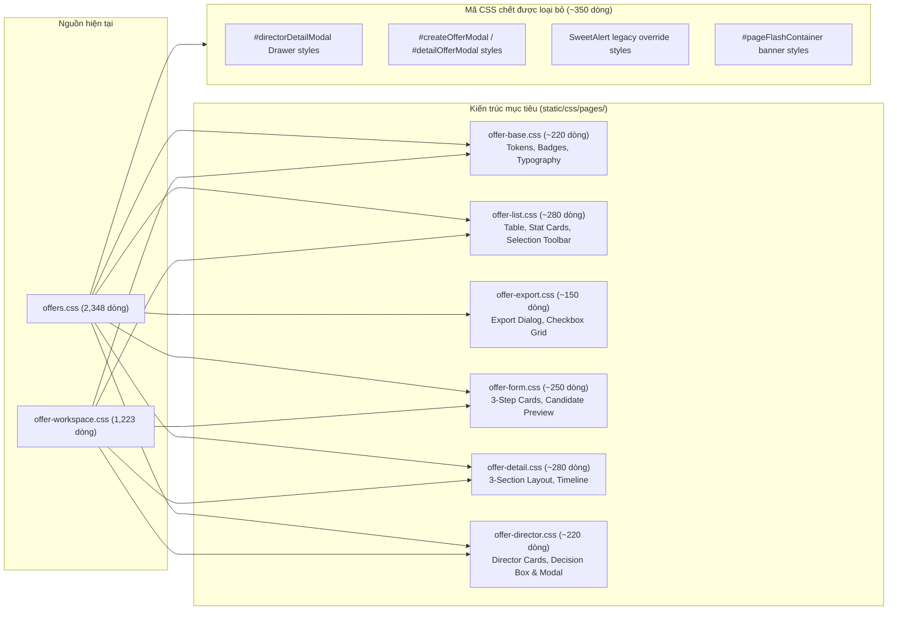

> Ghi chú 11/11/2026: đường dẫn CSS trong tài liệu đã được cập nhật theo vị trí hiện hành; các kết quả Task/PR lịch sử được giữ nguyên.

# THIẾT KẾ KIẾN TRÚC MỤC TIÊU CHO JAVASCRIPT VÀ CSS PHÂN HỆ OFFER (TASK 10)

> **Lưu ý khi đọc:** Tài liệu lịch sử: phản ánh thời điểm audit/refactor; tên hàm, đường dẫn và đề xuất có thể khác code đã merge. Xem [mục lục và hướng dẫn hiện hành](../README.md).
## SWP391 — Mộc RMS Group 2 | Developer: HuyenPT (Offer Management)
*Mã tài liệu: 18-task-10-js-css-target-structure.md*
*Thời gian thực hiện: 04/11/2026 | Nhánh Git: `refactor/huyenpt/offer-ui-js-to-html-css`*

---

## 1. MỤC TIÊU KIẾN TRÚC VÀ NGUYÊN TẮC THIẾT KẾ

Mục tiêu của thiết kế kiến trúc mục tiêu:
1. **Chia nhỏ tệp nguyên khối (Monolith Splitting):** Chuyển đổi từ một tệp `offers.js` (1.561 dòng) và `offers.css` (2.348 dòng) thành các tệp độc lập theo vai trò và màn hình với kích thước chuẩn **100–250 dòng/tệp**.
2. **Nguyên tắc trách nhiệm đơn nhất (Single Responsibility Principle):** Mỗi tệp chỉ đảm nhiệm đúng một vai trò người dùng hoặc một nhóm tương tác nghiệp vụ gắn với trang tương ứng.
3. **Bảo toàn khả năng truy cập toàn cục (Global Scope Preservation):** Vì các template Thymeleaf hiện tại đang sử dụng các thuộc tính inline `onclick="..."`, `oninput="..."`, `onchange="..."`, các tệp JavaScript sẽ **KHÔNG sử dụng `type="module"`** (tránh biến hàm thành module-scoped khiến HTML inline không tìm thấy), mà sẽ sử dụng mô hình đóng gói an toàn (Clean Namespace / Window Exports) rõ ràng.
4. **Không phụ thuộc vòng tròn (Zero Circular Dependencies):** Sắp xếp thứ tự nạp thẻ `<script defer>` sao cho các tệp phụ thuộc luôn nạp sau tệp dùng chung (`offer-common.js`).
5. **Tách bạch CSS theo tầng (Layered CSS Architecture):** Giữ nguyên tầng tokens & base, chia tách phần hiển thị theo màn hình, loại bỏ triệt để các selector của các popup/drawer đã xóa bỏ.

---

## 2. SƠ ĐỒ KIẾN TRÚC MỤC TIÊU (PROPOSED MODULAR ARCHITECTURE)

```mermaid
graph TD
    subgraph Templates ["Thymeleaf Templates"]
        T_HR_List["offers/list.html<br/>(HR Offer Workspace)"]
        T_Form["offers/form.html<br/>(Create/Edit Offer)"]
        T_Detail["offers/detail.html<br/>(Offer Detail View)"]
        T_Dir_List["offers/director-list.html<br/>(Director Workspace)"]
        T_Cand_List["offers/candidate-list.html<br/>(Candidate List)"]
        T_Cand_Detail["offers/candidate-detail.html<br/>(Candidate Detail)"]
    end

    subgraph Modular_JS ["Modular JavaScript (static/js/pages/offers/)"]
        JS_Common["offer-common.js (~110 dòng)<br/><i>CSRF, Toast, Send Offer Modal</i>"]
        JS_List["offer-list.js (~175 dòng)<br/><i>HR Filters, Row Selection, Delete Draft</i>"]
        JS_Export["offer-export.js (~210 dòng)<br/><i>Export Modal, 25 Cols, Blob Download</i>"]
        JS_Form["offer-form.js (~155 dòng)<br/><i>Candidate Autofill, 85% Salary, Start Date</i>"]
        JS_Detail["offer-detail.js (~160 dòng)<br/><i>Detail Director Decision, Counter, Scroll</i>"]
        JS_Director["offer-director.js (~185 dòng)<br/><i>Director Filters, Quick Decision Modal</i>"]
        JS_Candidate["candidate-offers.js (285 dòng)<br/><i>Countdown, Reason Chips, Double-submit Block</i>"]
    end

    subgraph Modular_CSS ["Modular CSS (static/css/pages/)"]
        CSS_Base["offer-base.css (~220 dòng)<br/><i>Tokens, Status Badges, Typography, Alerts</i>"]
        CSS_List["offer-list.css (~280 dòng)<br/><i>Table layout, Stat Cards, Selection Toolbar</i>"]
        CSS_Export["offer-export.css (~150 dòng)<br/><i>Export Dialog, Scope Radios, Checkbox Grid</i>"]
        CSS_Form["offer-form.css (~250 dòng)<br/><i>3-Step Form Cards, Candidate Preview, Rules</i>"]
        CSS_Detail["offer-detail.css (~280 dòng)<br/><i>3-Section Layout, Timeline, Dialogs</i>"]
        CSS_Director["offer-director.css (~220 dòng)<br/><i>Director Cards, Decision Card, Decision Modal</i>"]
        CSS_Candidate["candidate-offers.css (2,513 dòng)<br/><i>Candidate Portal UI Styles</i>"]
    end

    %% Template to JS mappings
    T_HR_List -->|defer (1)| JS_Common
    T_HR_List -->|defer (2)| JS_List
    T_HR_List -->|defer (3)| JS_Export
    T_HR_List -->|defer (4)| JS_Director

    T_Form -->|defer (1)| JS_Common
    T_Form -->|defer (2)| JS_Form

    T_Detail -->|defer (1)| JS_Common
    T_Detail -->|defer (2)| JS_Detail

    T_Dir_List -->|defer (1)| JS_Common
    T_Dir_List -->|defer (2)| JS_Director

    T_Cand_List -->|defer| JS_Candidate
    T_Cand_Detail -->|defer| JS_Candidate

    %% Template to CSS mappings
    T_HR_List --> CSS_Base
    T_HR_List --> CSS_List
    T_HR_List --> CSS_Export
    T_HR_List --> CSS_Director

    T_Form --> CSS_Base
    T_Form --> CSS_Form

    T_Detail --> CSS_Base
    T_Detail --> CSS_Detail
    T_Detail --> CSS_Director

    T_Dir_List --> CSS_Base
    T_Dir_List --> CSS_List
    T_Dir_List --> CSS_Director

    T_Cand_List --> CSS_Candidate
    T_Cand_Detail --> CSS_Candidate
```

---

## 3. THIẾT KẾ CHI TIẾT CÁC TỆP JAVASCRIPT MỤC TIÊU

Thư mục lưu trữ: `src/main/resources/static/js/pages/offers/`

### 3.1. `offer-common.js` (Ước tính: ~110 dòng)
- **Trách nhiệm:** Cung cấp tiện ích dùng chung giữa các trang Offer nội bộ (CSRF, thông báo Toast kết nối với hệ thống, và Modal xác nhận Gửi thư mời dùng chung giữa List và Detail).
- **Danh sách hàm cụ thể:**
  1. `getCsrfInfo()`: Đọc `_csrf` và `_csrf_header` từ `<meta>` tag phục vụ các lệnh gọi `fetch()`.
  2. `escapeOfferHtml(str)`: Khử ký tự HTML độc hại trong các chuỗi thông báo nhằm chống XSS.
  3. `showFlashToast(message, type)`: Hiển thị Flash Toast thông báo phản hồi (tích hợp với `flash-toast.css`).
  4. `confirmSendOffer(offerId)`: Thiết lập form modal xác nhận gửi thư mời tới ứng viên.
  5. `executeSendOfferAction()`: Nộp form POST `/offers/{id}/send` sang controller.
- **Biến toàn cục xuất ra window:**
  - `window.getCsrfInfo = getCsrfInfo;`
  - `window.showFlashToast = showFlashToast;`
  - `window.confirmSendOffer = confirmSendOffer;`
  - `window.executeSendOfferAction = executeSendOfferAction;`

---

### 3.2. `offer-list.js` (Ước tính: ~175 dòng)
- **Trách nhiệm:** Quản lý toàn bộ tương tác trên bảng danh sách của Chuyên viên Tuyển dụng (`offers/list.html`).
- **Danh sách hàm cụ thể:**
  1. `applyOfferFilters()`: Thu thập giá trị ô tìm kiếm, trạng thái lọc, sắp xếp thời gian và chuyển trang URL.
  2. `filterOffersByStatus(status)`: Cập nhật giá trị thẻ lọc trạng thái và gọi `applyOfferFilters()`.
  3. `clearSearchInput()`: Xóa sạch từ khóa tìm kiếm và reset về trang đầu tiên.
  4. `getSelectedOfferIds()`: Duyệt tìm tất cả các checkbox `.offer-row-checkbox:checked` và trả về mảng ID.
  5. `toggleSelectAllOffers(isChecked)`: Tích/bỏ tích toàn bộ checkbox trên bảng.
  6. `handleOfferRowSelectionChange()`: Kiểm tra số dòng được chọn để cập nhật trạng thái `indeterminate` của checkbox header.
  7. `deselectAllOffers()`: Xóa trạng thái chọn của tất cả các dòng.
  8. `updateSelectionToolbar()`: Ẩn/hiện thanh công cụ thao tác hàng loạt (`#selectionToolbar`) và cập nhật số lượng dòng đã chọn.
  9. `confirmDeleteOffer(offerId)`: Mở hộp thoại xác nhận và gọi API `DELETE /offers/{id}` để xóa bản nháp.
- **Biến toàn cục xuất ra window:**
  - `window.applyOfferFilters = applyOfferFilters;`
  - `window.filterOffersByStatus = filterOffersByStatus;`
  - `window.clearSearchInput = clearSearchInput;`
  - `window.toggleSelectAllOffers = toggleSelectAllOffers;`
  - `window.handleOfferRowSelectionChange = handleOfferRowSelectionChange;`
  - `window.deselectAllOffers = deselectAllOffers;`
  - `window.confirmDeleteOffer = confirmDeleteOffer;`

---

### 3.3. `offer-export.js` (Ước tính: ~210 dòng)
- **Trách nhiệm:** Quản lý modal xuất Excel, tùy biến 25 cột dữ liệu và tải xuống tệp nhị phân `.xlsx`.
- **Danh sách hàm cụ thể:**
  1. `openExportModal()`: Mở popup xuất Excel với phạm vi mặc định.
  2. `openExportModalWithScope(scope)`: Mở popup xuất Excel và tự động chọn phạm vi 'SELECTED' khi bấm từ thanh thao tác hàng loạt.
  3. `closeExportModal()`: Đóng popup xuất Excel.
  4. `handleExportModalBackdropClick(event)`: Đóng popup khi click vào vùng mờ backdrop.
  5. `handleScopeChange()`: Cập nhật số lượng bản ghi ước tính theo radio phạm vi (Tất cả / Đang lọc / Đã chọn).
  6. `selectAllColumns()`: Tích chọn toàn bộ 25 cột.
  7. `deselectAllColumns()`: Bỏ chọn tất cả các cột.
  8. `resetDefaultColumns()`: Khôi phục 10 cột thiết yếu theo cấu hình mặc định.
  9. `executeOfferExport()`: Thu thập phạm vi và danh sách cột, gửi AJAX POST `/offers/export` và kích hoạt tải file Blob.
- **Biến toàn cục xuất ra window:**
  - `window.openExportModal = openExportModal;`
  - `window.openExportModalWithScope = openExportModalWithScope;`
  - `window.closeExportModal = closeExportModal;`
  - `window.handleExportModalBackdropClick = handleExportModalBackdropClick;`
  - `window.handleScopeChange = handleScopeChange;`
  - `window.selectAllColumns = selectAllColumns;`
  - `window.deselectAllColumns = deselectAllColumns;`
  - `window.resetDefaultColumns = resetDefaultColumns;`
  - `window.executeOfferExport = executeOfferExport;`

---

### 3.4. `offer-form.js` (Ước tính: ~155 dòng)
- **Trách nhiệm:** Quản lý tương tác nhập liệu trên biểu mẫu Tạo mới và Chỉnh sửa đề xuất (`offers/form.html`).
- **Danh sách hàm cụ thể:**
  1. `handleSelectPassedCandidate(appId)`: Đọc thuộc tính `data-*` từ option được chọn, tự động điền vào khối xem trước Group A và gợi ý chức danh/lương.
  2. `autoCalculateProbationSalary(forceSet)`: Tự động tính mức lương thử việc tối thiểu 85% lương chính thức theo Luật Lao Động 2019.
  3. `validateProbationRuleUi()`: Kiểm tra tỷ lệ lương và hiển thị cảnh báo visual (đổi màu viền, hiện icon cảnh báo nếu <85% hoặc >100%).
  4. `updateMinExpectedStartDate()`: Tính toán động ngày bắt đầu tối thiểu: `min = Ngày tạo + Thời hạn phản hồi + 1 ngày` để ngăn chặn chọn ngày trong quá khứ.
  5. `initOfferFormExpectedStartDateMin()`: Gắn sự kiện `input` và `change` vào trường thời hạn phản hồi khi trang được tải.
- **Khởi tạo DOMContentLoaded nội bộ:** Chỉ chạy trên `form.html`, tự động kích hoạt tính toán nếu form mở lại do validation lỗi từ server.
- **Biến toàn cục xuất ra window:**
  - `window.handleSelectPassedCandidate = handleSelectPassedCandidate;`
  - `window.autoCalculateProbationSalary = autoCalculateProbationSalary;`
  - `window.validateProbationRuleUi = validateProbationRuleUi;`
  - `window.updateMinExpectedStartDate = updateMinExpectedStartDate;`

---

### 3.5. `offer-detail.js` (Ước tính: ~160 dòng)
- **Trách nhiệm:** Quản lý các tương tác trên trang Xem chi tiết Đề xuất (`offers/detail.html`).
- **Danh sách hàm cụ thể:**
  1. `updateDirectorDetailCommentCounter(el)`: Đếm ký tự thực thời trên ô nhận xét của Giám đốc (`#directorDetailComments`) và tự động xóa cảnh báo lỗi khi người dùng bắt đầu gõ.
  2. `scrollToDirectorDecision()`: Cuộn mượt màn hình tới khung Quyết định của Giám đốc khi bấm nút ở đầu trang.
  3. `submitDirectorDecisionFromScreen(offerId, action)`: Điều phối khi Giám đốc bấm nút Duyệt hoặc Từ chối trên trang chi tiết; mở hộp thoại HTML5 `<dialog>` tương ứng.
  4. `confirmDirectorApproveAction()`: Xác nhận duyệt từ dialog và kích hoạt `executeDirectorDecisionApi`.
  5. `confirmDirectorRejectAction()`: Xác nhận từ chối từ dialog và kích hoạt `executeDirectorDecisionApi`.
  6. `executeDirectorDecisionApi(offerId, url, comments)`: Gửi yêu cầu AJAX POST JSON tới `/offers/{id}/approve` hoặc `/offers/{id}/reject`.
- **Biến toàn cục xuất ra window:**
  - `window.updateDirectorDetailCommentCounter = updateDirectorDetailCommentCounter;`
  - `window.scrollToDirectorDecision = scrollToDirectorDecision;`
  - `window.submitDirectorDecisionFromScreen = submitDirectorDecisionFromScreen;`
  - `window.confirmDirectorApproveAction = confirmDirectorApproveAction;`
  - `window.confirmDirectorRejectAction = confirmDirectorRejectAction;`

---

### 3.6. `offer-director.js` (Ước tính: ~185 dòng)
- **Trách nhiệm:** Quản lý giao diện danh sách của Giám đốc (`offers/director-list.html`) và hộp thoại phê duyệt/từ chối nhanh (`#directorDecisionModal`) dùng chung trên cả `director-list.html` và `list.html`.
- **Danh sách hàm cụ thể:**
  1. `applyDirectorFilters()`: Lọc danh sách Giám đốc theo từ khóa và sắp xếp thời gian.
  2. `filterDirectorOffersByStatus(status)`: Chuyển tab trạng thái của Giám đốc (Chờ duyệt / Đã duyệt / Đã từ chối).
  3. `clearDirectorSearch()`: Xóa từ khóa tìm kiếm trên danh sách Giám đốc.
  4. `openDirectorDecisionModal(offerId, actionType)`: Mở hộp thoại phê duyệt/từ chối nhanh, điều chỉnh tiêu đề, nhãn bắt buộc và placeholder tương ứng với hành động APPROVE hoặc REJECT.
  5. `handleDirectorDecisionCommentInput(textarea)`: Đếm ký tự và xóa lỗi khi gõ vào ô nhận xét trong modal.
  6. `closeDirectorDecisionModal()`: Đóng modal quyết định nhanh và xóa sạch trạng thái lỗi.
  7. `submitDirectorDecision()`: Kiểm tra hợp lệ (bắt buộc nhập lý do khi REJECT) và gửi AJAX POST JSON duyệt/từ chối.
- **Biến toàn cục xuất ra window:**
  - `window.applyDirectorFilters = applyDirectorFilters;`
  - `window.filterDirectorOffersByStatus = filterDirectorOffersByStatus;`
  - `window.clearDirectorSearch = clearDirectorSearch;`
  - `window.openDirectorDecisionModal = openDirectorDecisionModal;`
  - `window.handleDirectorDecisionCommentInput = handleDirectorDecisionCommentInput;`
  - `window.closeDirectorDecisionModal = closeDirectorDecisionModal;`
  - `window.submitDirectorDecision = submitDirectorDecision;`

---

### 3.7. `candidate-offers.js` (Giữ nguyên kích thước 285 dòng)
- **Trách nhiệm:** Quản lý toàn bộ trải nghiệm ứng viên tại Candidate Portal (`offers/candidate-list.html` và `offers/candidate-detail.html`).
- **Nghiệp vụ cốt lõi:**
  1. Đồng bộ chip lý do từ chối nhanh (`.cof-chip`) với trường textarea phản hồi.
  2. Hộp thoại xác nhận Đồng ý / Từ chối thư mời nhận việc.
  3. Bộ đếm ngược thời gian phản hồi theo thời gian thực (tính chính xác đến từng giây, xử lý trạng thái hết hạn).
  4. Chặn gửi hai lần (double-submit prevention) và phục hồi trạng thái nút khi bấm nút Back trên trình duyệt (`pageshow`).
  5. In ấn thư mời nhận việc chuẩn PDF (`window.print()`).

---

## 4. THIẾT KẾ CHI TIẾT CÁC TỆP CSS MỤC TIÊU

Thư mục lưu trữ: `src/main/resources/static/css/pages/`

Hiện tại, mã CSS đang bị phân tán giữa `offers.css` (2.348 dòng) và `offer-workspace.css` (1.223 dòng), trong đó có rất nhiều rule trùng lặp hoặc thuộc về các modal cũ đã bị loại bỏ. Kiến trúc mục tiêu sẽ hợp nhất và phân tách thành 6 tệp CSS gọn gàng:



### 4.1. `offer-base.css` (~220 dòng)
- **Chứa:** Các biến giao diện (Design Tokens) của phân hệ Offer (`--brand-dark: #1e3a2b`, `--brand-main: #2d5a3f`, v.v.), typography, breadcrumb, tiêu đề trang, và toàn bộ hệ thống huy hiệu trạng thái (`.status-badge--*`, `.ofw-badge`).
- **Sử dụng:** Nạp đầu tiên trên tất cả 4 màn hình Offer nội bộ.

### 4.2. `offer-list.css` (~280 dòng)
- **Chứa:** Khung bảng dữ liệu (`.ofw-table-container`), kiểu dáng các ô dữ liệu, thẻ tóm tắt số liệu (`.ofw-stat-card`, `.stat-overview-cards`), thanh tìm kiếm và lọc (`.ofw-toolbar`), thanh công cụ chọn hàng loạt (`.ofw-selection-toolbar`, `#selectionToolbar`), phân trang.
- **Sử dụng:** `offers/list.html` và `offers/director-list.html`.

### 4.3. `offer-export.css` (~150 dòng)
- **Chứa:** Toàn bộ kiểu dáng của modal xuất Excel (`#offerExportModal`), lưới 25 checkbox cột xuất (`.ofw-export-col-grid`), thẻ chọn phạm vi (Radio cards), thanh trạng thái số lượng ước tính.
- **Sử dụng:** Riêng cho `offers/list.html`.

### 4.4. `offer-form.css` (~250 dòng)
- **Chứa:** Bố cục biểu mẫu tạo mới/chỉnh sửa 3 bước (`.ofw-surface-card`), khung xem trước thông tin ứng viên trúng tuyển (Group A), khung nhập điều khoản và lương, biểu ngữ cảnh báo vi phạm quy định 85% lương thử việc (`#probationRuleNotice`), thanh nút hành động chân trang (`.ofw-form-actions`).
- **Sử dụng:** Riêng cho `offers/form.html`.

### 4.5. `offer-detail.css` (~280 dòng)
- **Chứa:** Bố cục 3 phần của trang chi tiết: Khung tóm tắt đánh giá phỏng vấn, thẻ chỉ số đãi ngộ (KPI Cards), 3 thẻ ngày tháng quan trọng, hộp địa điểm & phúc lợi, lịch sử thay đổi và nhật ký hệ thống (Timeline).
- **Sử dụng:** Riêng cho `offers/detail.html`.

### 4.6. `offer-director.css` (~220 dòng)
- **Chứa:** Kiểu dáng riêng cho vai trò Giám đốc: Thẻ thống kê thu gọn nằm ngang trên danh sách (`.ofw-director-stat`), khung thẻ quyết định Giám đốc trên trang chi tiết (`.director-decision-card`), và hộp thoại quyết định nhanh (`#directorDecisionModal`).
- **Sử dụng:** `offers/director-list.html`, `offers/detail.html`, `offers/list.html`.

---

## 5. MA TRẬN ÁNH XẠ TEMPLATE SANG TỆP NGUỒN MỤC TIÊU

Dưới đây là cấu hình tham chiếu tài nguyên chính xác sau khi hoàn thành tái cấu trúc cho từng template:

| Template | Các tệp CSS cần nạp (`<link rel="stylesheet">`) | Các tệp JS cần nạp (`<script defer>`) |
| :--- | :--- | :--- |
| [`offers/list.html`](file:///c:/Users/Admin/Documents/Ky_5/SWP391/SWP_RMS_Group-2/src/main/resources/templates/offers/list.html) | 1. `/css/pages/offer-base.css`<br/>2. `/css/pages/offer-list.css`<br/>3. `/css/pages/offer-export.css`<br/>4. `/css/pages/offer-director.css`<br/>5. `/css/pages/flash-toast.css` | 1. `/js/pages/flash-toast.js`<br/>2. `/js/pages/offers/offer-common.js`<br/>3. `/js/pages/offers/offer-list.js`<br/>4. `/js/pages/offers/offer-export.js`<br/>5. `/js/pages/offers/offer-director.js` |
| [`offers/form.html`](file:///c:/Users/Admin/Documents/Ky_5/SWP391/SWP_RMS_Group-2/src/main/resources/templates/offers/form.html) | 1. `/css/pages/offer-base.css`<br/>2. `/css/pages/offer-form.css`<br/>3. `/css/pages/flash-toast.css` | 1. `/js/pages/flash-toast.js`<br/>2. `/js/pages/offers/offer-common.js`<br/>3. `/js/pages/offers/offer-form.js` |
| [`offers/detail.html`](file:///c:/Users/Admin/Documents/Ky_5/SWP391/SWP_RMS_Group-2/src/main/resources/templates/offers/detail.html) | 1. `/css/pages/offer-base.css`<br/>2. `/css/pages/offer-detail.css`<br/>3. `/css/pages/offer-director.css`<br/>4. `/css/pages/flash-toast.css` | 1. `/js/pages/flash-toast.js`<br/>2. `/js/pages/offers/offer-common.js`<br/>3. `/js/pages/offers/offer-detail.js` |
| [`offers/director-list.html`](file:///c:/Users/Admin/Documents/Ky_5/SWP391/SWP_RMS_Group-2/src/main/resources/templates/offers/director-list.html) | 1. `/css/pages/offer-base.css`<br/>2. `/css/pages/offer-list.css`<br/>3. `/css/pages/offer-director.css`<br/>4. `/css/pages/flash-toast.css` | 1. `/js/pages/flash-toast.js`<br/>2. `/js/pages/offers/offer-common.js`<br/>3. `/js/pages/offers/offer-director.js` |
| [`offers/candidate-list.html`](file:///c:/Users/Admin/Documents/Ky_5/SWP391/SWP_RMS_Group-2/src/main/resources/templates/offers/candidate-list.html) | 1. `/css/pages/candidate-offers.css`<br/>2. `/css/pages/flash-toast.css` | 1. `/js/pages/flash-toast.js`<br/>2. `/js/pages/candidate-offers.js` |
| [`offers/candidate-detail.html`](file:///c:/Users/Admin/Documents/Ky_5/SWP391/SWP_RMS_Group-2/src/main/resources/templates/offers/candidate-detail.html) | 1. `/css/pages/candidate-offers.css`<br/>2. `/css/pages/flash-toast.css` | 1. `/js/pages/flash-toast.js`<br/>2. `/js/pages/candidate-offers.js` |

> [!TIP] Lợi ích vượt trội của cấu hình mục tiêu:
> - **Hiệu năng tải trang tối ưu:** Trang Form tạo mới không còn phải tải mã Export 25 cột hay mã xử lý duyệt của Giám đốc. Số dòng JS cần nạp cho trang Form giảm từ 1.561 dòng xuống chỉ còn **~265 dòng** (`offer-common.js` + `offer-form.js`).
> - **Cách ly phạm vi lỗi (Fault Isolation):** Lỗi cú pháp hoặc thay đổi trên màn hình Danh sách hoàn toàn không thể gây ảnh hưởng đến hoạt động nộp Form hay trang Chi tiết của Giám đốc.
