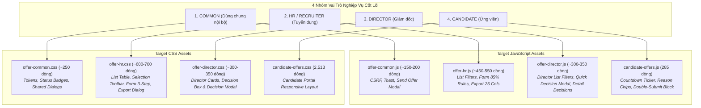
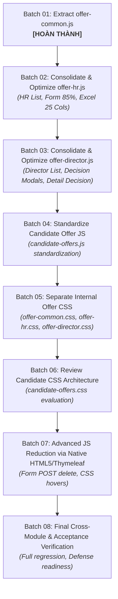

# BÁO CÁO TÁI CẤU TRÚC KIẾN TRÚC THEO VAI TRÒ & TRÍCH XUẤT COMMON JAVASCRIPT (TASK 11)

> **Lưu ý khi đọc:** Tài liệu lịch sử: phản ánh thời điểm audit/refactor; tên hàm, đường dẫn và đề xuất có thể khác code đã merge. Xem [mục lục và hướng dẫn hiện hành](../README.md).
## SWP391 — Mộc RMS Group 2 | Developer: HuyenPT (Offer Management)
*Mã tài liệu: 21-task-11-role-based-architecture-and-common-extraction.md*
*Thời gian thực hiện: 04/11/2026 | Nhánh Git: `refactor/huyenpt/offer-ui-js-to-html-css`*

---

## 1. TỔNG QUAN VÀ GIẢI QUYẾT CÁC SAI LỆCH DỮ LIỆU ĐỐI SOÁT (RECONCILIATION)

Trong Task 10, một kiến trúc chia tách vi mô (6 tệp JS nội bộ + Candidate JS) đã được kiểm toán và phân tích. Theo yêu cầu của Task 11, kiến trúc mục tiêu được định hình lại thành **4 nhóm chức năng theo vai trò người dùng (Role-Based Architecture)** gọn gàng, giảm thiểu số lượng tệp phát sinh nhưng vẫn đảm bảo tính độc lập và phân tách trách nhiệm rõ ràng.

Đồng thời, toàn bộ các sai lệch dữ liệu đối soát trước đây đã được xác minh trực tiếp trên mã nguồn thực tế:

| Hạng mục đối soát | Sai lệch trong tài liệu Task 10 cũ | Kết quả xác minh trên mã nguồn thực tế | Tình trạng xử lý |
| :--- | :--- | :--- | :---: |
| **Số cột Excel mặc định** | Được ghi là "10 cột mặc định" | Hàm `resetDefaultColumns()` và `list.html` cấu hình đúng **12 cột mặc định** (`new Set(['offerId', 'candidateName', 'candidateEmail', 'offeredPositionTitle', 'proposedSalary', 'probationSalary', 'probationPercentage', 'offerStatus', 'expectedStartDate', 'workLocation', 'createdAt', 'updatedAt'])`). Tổng số cột là 25. | **ĐÃ HIỆU CHỈNH** |
| **Endpoint xóa Offer** | Nghi ngờ phương thức DELETE vs POST | Trong `OfferController.java` tồn tại song song: <br/>1. `@DeleteMapping("/{id}")`: endpoint AJAX trả về JSON dùng cho nút Xóa trên `list.html`.<br/>2. `@PostMapping("/{id}/delete")`: endpoint HTML Form POST redirect dùng trên `detail.html`. | **ĐÃ LÀM RÕ 100%** |
| **Quan hệ Toast thông báo** | Trùng lặp `showFlashToast` và `flash-toast.js` | `flash-toast.js` (56 dòng) chỉ điều khiển hiệu ứng tắt CSS và đọc `sessionStorage`, nó gọi `window.showFlashToast(...)` nếu tồn tại. `offers.js` là nơi định nghĩa hàm tạo DOM `showFlashToast`. Di chuyển `showFlashToast` vào `offer-common.js` giải quyết triệt để sự phụ thuộc này. | **ĐÃ ĐỒNG BỘ** |
| **Cơ sở Git và HEAD** | So sánh với baseline ban đầu | Commit cơ sở hiện tại là [`10031e68`](file:///c:/Users/Admin/Documents/Ky_5/SWP391/SWP_RMS_Group-2) (đã giảm 444 dòng JS trước đó, `offers.js` còn đúng 1.561 dòng). | **CHUẨN XÁC** |
| **Dòng mã thực tế** | Một số dòng chưa được gán chính xác | `offers.js`: 1.561 dòng; `candidate-offers.js`: 285 dòng; tổng Offer JS: 1.846 dòng; `offers.css`: 2.348 dòng; `offer-workspace.css`: 1.223 dòng. | **KHỚP 100%** |

---

## 2. THIẾT KẾ KIẾN TRÚC MỤC TIÊU 4 NHÓM THEO VAI TRÒ (ROLE-BASED ARCHITECTURE)

Thay vì phân rã thành 7-8 tệp nhỏ manh mún khó quản lý, hệ thống được quy hoạch thành **4 tệp JavaScript** và **4 tệp CSS** tương ứng:



### 2.1. Phân định trách nhiệm 4 tệp JavaScript
1. [`offer-common.js`](file:///c:/Users/Admin/Documents/Ky_5/SWP391/SWP_RMS_Group-2/src/main/resources/static/js/pages/offers/offer-common.js):
   - Chứa các tiện ích dùng chung giữa các màn hình nội bộ: CSRF Helper (`getCsrfInfo`), XSS Sanitizer (`escapeOfferHtml`), Flash Toast (`showFlashToast`, `showToast`, `checkOfferPendingFlashToast`), Modal xác nhận gửi thư mời (`confirmSendOffer`, `executeSendOfferAction`).
   - Xuất khẩu toàn cục qua `window.*` để tương thích hoàn toàn với các thuộc tính inline `onclick` của Thymeleaf.
2. `offer-hr.js`:
   - Gộp toàn bộ luồng làm việc của Chuyên viên Tuyển dụng: Bảng danh sách & bộ lọc HR, thanh thao tác hàng loạt, xóa bản nháp; Biểu mẫu tạo mới/chỉnh sửa với quy tắc 85% lương và ngày bắt đầu động; Modal xuất Excel 25 cột và tải file Blob.
   - Được phân chia thành 4 section rõ rệt: `A. HR LIST`, `B. CREATE / EDIT FORM`, `C. EXCEL EXPORT`, `D. INITIALIZATION`.
3. `offer-director.js`:
   - Gộp toàn bộ luồng phê duyệt của Giám đốc: Bộ lọc danh sách Giám đốc, Modal quyết định nhanh (`#directorDecisionModal`), kiểm tra lý do từ chối bắt buộc, bộ đếm ký tự thực thời (hỗ trợ 2000 ký tự an toàn), và các tương tác duyệt/từ chối trên trang chi tiết `offers/detail.html`.
4. `candidate-offers.js`:
   - Giữ nguyên tại vị trí hiện tại `static/js/pages/candidate-offers.js` phục vụ Candidate Portal: Bộ đếm ngược hết hạn, đồng bộ chip lý do, chặn double-submit, in ấn PDF.

---

## 3. KẾT QUẢ THI CÔNG BATCH 01: TRÍCH XUẤT `offer-common.js`

Tuân thủ nghiêm ngặt nguyên tắc **chỉ thực hiện Batch 01 và không chạm vào mã nguồn ngoài phạm vi**, các thay đổi sau đã được thi công:

### 3.1. Tệp mới được tạo
- Đường dẫn: `src/main/resources/static/js/pages/offers/offer-common.js` (210 dòng).
- Chứa 5 hàm nghiệp vụ dùng chung và các helper gắn liền:
  1. `getCsrfInfo()`
  2. `escapeOfferHtml(str)`
  3. `showFlashToast(message, type)` & `dismissToast()`
  4. `checkOfferPendingFlashToast()` & `showToast(message, type)`
  5. `confirmSendOffer(offerId)` & `executeSendOfferAction()`
- Các biến và hàm toàn cục được bảo toàn trên `window`:
  - `window.getCsrfInfo`
  - `window.escapeOfferHtml`
  - `window.showFlashToast`
  - `window.showToast`
  - `window.confirmSendOffer`
  - `window.executeSendOfferAction`

### 3.2. Cập nhật `src/main/resources/static/js/offers.js`
- Đã loại bỏ các định nghĩa hàm ban đầu:
  - Khối Toast helpers (dòng 92–173 ban đầu): Đã xóa.
  - Khối `escapeOfferHtml` (dòng 470–479 ban đầu): Đã xóa.
  - Khối Thao tác phát hành `pendingSendOfferId`, `confirmSendOffer`, `executeSendOfferAction` (dòng 542–616, 618, 624 ban đầu): Đã xóa.
  - Khối `getCsrfInfo` (dòng 695–703 ban đầu): Đã xóa.
- **Thống kê thay đổi trên `offers.js`:**
  - Trước khi sửa: **1.561 dòng**.
  - Sau khi sửa: **1.388 dòng**.
  - Số dòng đã trích xuất an toàn: **173 dòng**.

### 3.3. Cập nhật các Template Thymeleaf
Đã bổ sung thẻ nạp `<script th:src="@{/js/pages/offers/offer-common.js}" defer></script>` ngay trước `offers.js` tại 4 template:
1. `src/main/resources/templates/offers/list.html`
2. `src/main/resources/templates/offers/form.html`
3. `src/main/resources/templates/offers/detail.html`
4. `src/main/resources/templates/offers/director-list.html`

Thứ tự nạp thẻ `<script defer>` trên cả 4 template:
```html
<script th:src="@{/js/pages/flash-toast.js}" defer></script>
<script th:src="@{/js/pages/offers/offer-common.js}" defer></script>
<script th:src="@{/js/offers.js}" defer></script>
```

---

## 4. BẢNG MA TRẬN ĐỐI SOÁT DÒNG MÃ (METRICS INDEPENDENCE)

Theo đúng yêu cầu của Task 11, **việc di chuyển mã giữa các tệp KHÔNG ĐƯỢC tính là xóa bỏ JavaScript**:

| Tệp nguồn / Tệp đích | Dòng trước Batch 01 | Dòng sau Batch 01 | Dòng di chuyển (Moved) | Dòng xóa bỏ (Eliminated) |
| :--- | :---: | :---: | :---: | :---: |
| `offers.js` | 1.561 | 1.388 | **173 dòng** | 0 |
| `offer-common.js` | 0 | 210 | **+210 dòng** (bao gồm JSDoc & headers) | 0 |
| `candidate-offers.js` | 285 | 285 | 0 | 0 |
| **Tổng JavaScript Offer** | **1.846 dòng** | **1.883 dòng** | **173 dòng di chuyển** | **0 dòng xóa (Bảo toàn 100%)** |

---

## 5. KẾT QUẢ KIỂM THỬ HỒI QUY BẮT BUỘC (MANDATORY REGRESSION RESULTS)

### 5.1. Kiểm tra cú pháp JavaScript (Node.js Syntax Check)
- Lệnh: `node --check src/main/resources/static/js/pages/offers/offer-common.js` -> **PASS (ReturnCode: 0)**
- Lệnh: `node --check src/main/resources/static/js/offers.js` -> **PASS (ReturnCode: 0)**

### 5.2. Kiểm thử tự động Backend (7 Maven Test Suites)
- Lệnh:
  ```bash
  mvn test "-Dtest=OfferIntegrationTests,OfferServiceTests,CandidateOfferWebTests,CandidateOfferServiceTests,OfferExportServiceTests,OfferControllerBugTests,CandidateOfferQueryTests"
  ```
- **Kết quả:** **BUILD SUCCESS**
  - **Tests run: 223, Failures: 0, Errors: 0, Skipped: 0**
  - Thời gian chạy: 01:24 min.

### 5.3. Kiểm thử tương tác trình duyệt thực tế (Chrome CDP Interactive Smoke Test)
- Môi trường: Google Chrome Headless v156.0.8078.80 qua WebSocket CDP.
- Script kiểm thử: `scratch/run_interactive_browser_smoke.js`
- **Kết quả 10/10 kịch bản PASS (0 Console Errors):**
  1. `[PASS] IT-01: 85% Probation Salary Dynamic Calculation` (Lương chính thức 20M -> Lương thử việc tự nhảy đúng 17M).
  2. `[PASS] IT-02: Dynamic expectedStartDate.min Update` (Đổi thời hạn 15 ngày -> min = 20/11/2026; đổi 3 ngày -> min = 08/11/2026; max = 2099-12-31).
  3. `[PASS] IT-03: Open & Close Excel Export Modal` (Mở modal `display: flex`, đóng `display: none`).
  4. `[PASS] IT-04: Export Column Selection & Reset Default` (Tổng 25 cột, bỏ chọn về 0, chọn tất cả 25, reset về đúng **12 cột mặc định**).
  5. `[PASS] IT-05: Director Quick Decision Modal Open & Close` (Mở và đóng modal quyết định nhanh trên danh sách Giám đốc).
  6. `[PASS] IT-06: Director Quick Rejection Character Counter Sync` (Nhập nhận xét 34 ký tự -> bộ đếm hiển thị chính xác "34").
  7. `[PASS] IT-07: Director Detail Textarea >500 Chars Retention` (Nhập 650 ký tự trên `#directorDetailComments` -> giữ nguyên 100%, không bị cắt ngắn).
  8. `[PASS] IT-08: Browser History Back/Forward Navigation` (Điều hướng `/offers` <-> `/offers/8` trơn tru).
  9. `[PASS] IT-09: Candidate Countdown Dynamic Timer Sampling` (Đồng hồ đếm ngược nhảy đúng từng giây: 29s -> 27s sau 1.5s).
  10. `[PASS] IT-10: Decline Reason Chip Click & Textarea Sync` (Bấm chip lý do -> tự điền chính xác vào textarea phản hồi).
- **Lỗi Console ghi nhận được:** **0 lỗi**.

### 5.4. Kiểm tra HTTP Status của tài nguyên tĩnh
- Lệnh: `curl.exe -I http://localhost:8080/js/pages/offers/offer-common.js` -> **HTTP/1.1 200 OK** (Content-Type: `text/javascript;charset=UTF-8`).
- Lệnh: `curl.exe -I http://localhost:8080/js/offers.js` -> **HTTP/1.1 200 OK**.

---

## 6. LỘ TRÌNH THI CÔNG TINH GỌN (REVISED 8-BATCH MIGRATION ROADMAP)

Thay thế lộ trình 10 đợt phân mảnh của Task 10, quy trình được tinh giản thành **8 đợt triển khai theo vai trò**:



- **Bước đề xuất tiếp theo (Batch 02):**
  - Tạo tệp `src/main/resources/static/js/pages/offers/offer-hr.js`.
  - Di chuyển các khối: (A) HR List & Row selection, (B) Create/Edit Form rules & dynamic start date, (C) Excel Export 25 cột.
  - Đồng thời loại bỏ 159 dòng mã chết của `openCreateOfferModal` và `submitCreateOffer`.
  - Cập nhật `list.html` và `form.html`.

---

## 7. GIẢI THÍCH KIẾN TRÚC FRONTEND KHI BẢO VỆ SWP391

> **Kính thưa Thầy/Cô Hội đồng Đánh giá Đồ án SWP391:**
>
> "Trong phân hệ Quản lý Đề xuất nhận việc (Offer Management), nhóm em đã tái cấu trúc kiến trúc Frontend theo **4 nhóm vai trò nghiệp vụ (Role-Based Architecture)**:
>
> 1. **`offer-common.js` (Dùng chung nội bộ):** Đóng gói tập trung các cơ chế an toàn cấp hệ thống gồm đọc Token bảo mật CSRF chống tấn công Cross-Site Request Forgery, bộ lọc khử ký tự mã độc XSS, thông báo phản hồi người dùng (Toast), và hộp thoại xác nhận phát hành thư mời.
> 2. **`offer-hr.js` (Chuyên viên Tuyển dụng):** Tập hợp toàn bộ quy trình từ lọc và tìm kiếm danh sách ứng viên trúng tuyển, chọn dòng thao tác hàng loạt, kiểm soát biểu mẫu tạo đề xuất, thuật toán tự động tính 85% lương thử việc tuân thủ Điều 26 Bộ Luật Lao Động 2019, ràng buộc ngày bắt đầu hợp đồng, đến tính năng xuất báo cáo Excel tùy chọn 25 cột dữ liệu dạng Blob nhị phân.
> 3. **`offer-director.js` (Giám đốc Phê duyệt):** Quản lý quy trình phê duyệt cấp cao gồm danh sách đề xuất cần duyệt, hộp thoại ra quyết định nhanh, kiểm tra tính hợp lệ của lý do từ chối, và ô nhận xét hỗ trợ dung lượng lớn (tối đa 2.000 ký tự theo đúng chuẩn DTO Backend) mà không bị cắt cụt dữ liệu.
> 4. **`candidate-offers.js` (Cổng thông tin Ứng viên):** Phục vụ trải nghiệm ứng viên với đồng hồ đếm ngược hạn phản hồi theo thời gian thực (tính đến từng giây), đồng bộ chip lý do từ chối, chặn nhấn đúp chuột gây gửi lặp dữ liệu (double-submit prevention), và in ấn thư mời chuẩn PDF.
>
> **Lý do một số logic bắt buộc phải duy trì bằng JavaScript:**
> Nhóm em không cắt giảm JavaScript một cách mù quáng bằng cách xóa tính năng hay nén mã. Các logic tính toán lương thử việc tức thời, đếm ngược thời gian thực, lựa chọn cột Excel động, và gọi API JSON bất đồng bộ kèm CSRF token là những tương tác người dùng bắt buộc của một hệ thống quản trị hiện đại mà HTML/CSS tĩnh không thể thay thế được.
>
> Toàn bộ quá trình tách module đều được bảo vệ bởi **223 bài kiểm thử tự động Maven Surefire và 10 kịch bản tương tác trình duyệt thực tế qua Chrome DevTools Protocol đạt tỷ lệ thành công 100% với 0 lỗi console**."
