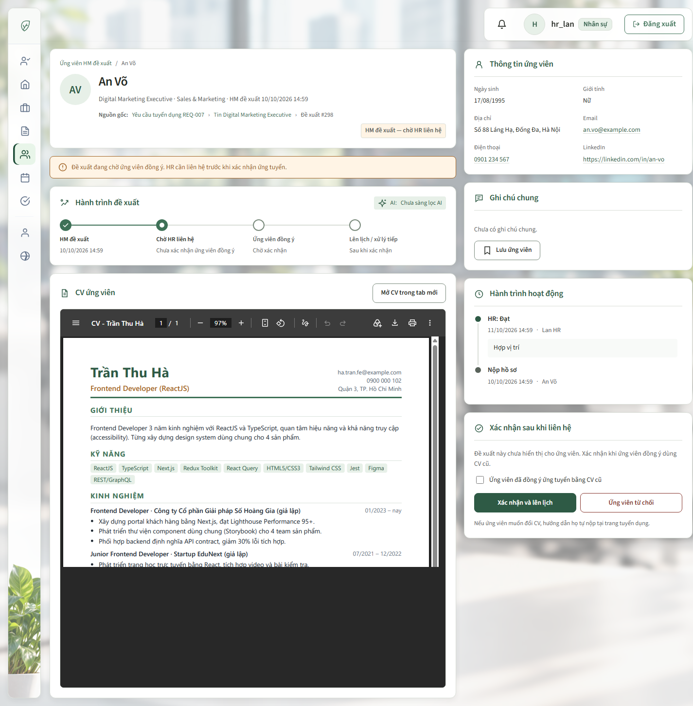
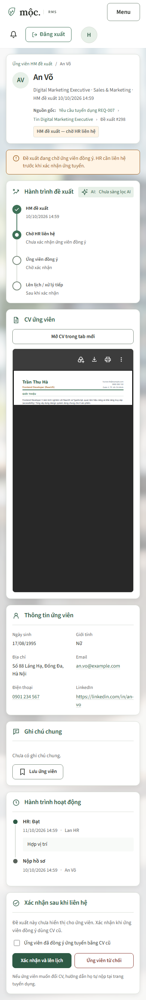

# 30/10/2026 — Đồng bộ giao diện chi tiết Application

**Người thực hiện:** LinhDN. **Trang:** `/applications/{id}`.

## Yêu cầu và kết quả

Đổi bố cục theo mockup, dùng cùng giao diện Mộc với Talent Pool / HR Recommend. Áp dụng UI UX Pro Max, Impeccable, Taste và Awesome Design Reference trong phạm vi hệ thiết kế đang có.

- Cột trái khoảng 64%: nhận diện ứng viên, trạng thái/nguồn gốc, thông báo chờ đồng ý, hành trình và CV.
- Cột phải khoảng 36%: thông tin ứng viên gọn hai cột, ghi chú chung, hoạt động và thao tác theo quyền.
- Thêm avatar từ tên; thu gọn khoảng cách và tiêu đề. Hành trình đề xuất thể hiện đủ 4 mốc, hai bước sau còn ở trạng thái chưa tới.
- Dùng lại nền văn phòng, màu xanh, card, nút và dialog catalog. Mobile chuyển một cột và hành trình dọc.
- Giữ nguyên dữ liệu, URL, form POST/CSRF, validation, phân quyền và luồng review/consent/CV. Không sửa backend hoặc database.

## Giao diện sau thay đổi

Ảnh chụp Chrome từ HTML được render qua MockMvc, dùng dữ liệu kiểm thử và PDF mẫu có sẵn; không phải tài khoản thật hoặc bằng chứng lưu dữ liệu vào SQL Server. Tên trong PDF mẫu khác tên hồ sơ fixture.

### Desktop

### Mobile

## File thay đổi và kiểm chứng

Danh sách file, số dòng thêm/xóa và phạm vi bảo toàn nằm trong [work log chi tiết](../../management/work_logs/2026-10-30-application-detail-ui.md#file-change).

- HTML: chuyển bố cục và dùng lại workspace/catalog; CSS riêng `application-detail.css`, chỉ nạp trên trang chi tiết.
- Kiểm thử MVC: cập nhật vị trí các khối, bổ sung kịch bản phân quyền/consent và xuất fixture HR/HM/Director.
- **67/67 MVC, 3/3 JavaScript qua**; chạy lại kịch bản 4 biến thể sau chỉnh dialog cũng qua.
- Chrome: kiểm tra desktop 1440px, tablet 768px, mobile 390px; không tràn ngang, không JS exception; các dialog mở/Hủy hoạt động.
- Không gửi mutation nghiệp vụ trong browser fixture; chưa chạy end-to-end với SQL Server/SMTP/CV thật. Không commit/push.

## Triage cảnh báo Impeccable

`flat-type-hierarchy` là báo nhầm: detector đọc HTML chưa nạp CSS ngoài và báo body/h1/h2 đều 16px. Trình duyệt đo tên ứng viên 26px desktop, 23px mobile; tiêu đề thẻ 17px; nội dung 13,5–15px. Giữ phân cấp hiện có và ghi ngoại lệ **chỉ quy tắc này trên file `candidate/application-detail.html`** qua CLI của skill. Chạy detect lại không còn finding; không tắt quy tắc toàn dự án. Cấu hình `.impeccable/config.json` hiện được Git ignore và được ghi nhận tại máy này.

## Cách ghi nhận các lượt sau

Mỗi lượt công việc có báo cáo theo ngày/chủ đề trong `docs/members/linhdn`, liên kết từ README và work log chung. Các lượt chỉnh FE bổ sung ảnh render có chú thích trạng thái/dữ liệu; ảnh lưu cùng repo dưới `assets/` để mở Markdown ở máy khác vẫn thấy. Lượt chỉ sửa backend/tài liệu không cần ảnh giao diện.
