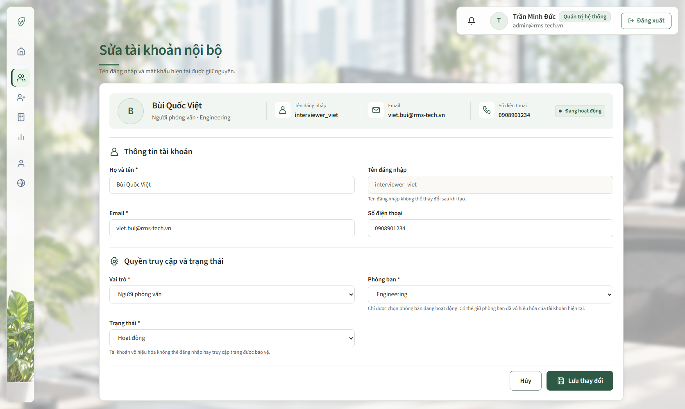
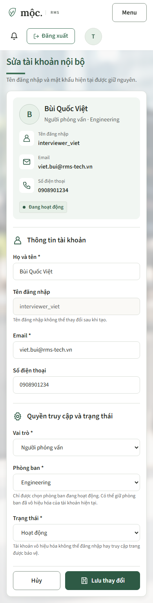

# 31/10/2026 — Giao diện Sửa tài khoản nội bộ

**Người thực hiện:** LinhDN. **Trang:** `/admin/accounts/{id}/edit`.

## Yêu cầu và kết quả

Làm phần nội dung theo mockup, dùng cùng giao diện Mộc của các trang nội bộ. Giữ nguyên sidebar, topbar, khung và hành vi điều hướng dùng chung.

- Dải tổng quan đầu thẻ: avatar chữ cái đầu, tên, vai trò/phòng ban, username, email, điện thoại và trạng thái.
- Dữ liệu tổng quan lấy từ tài khoản đang lưu, không lấy bản form đang nhập dở. Nếu submit gặp lỗi validation, dải tổng quan vẫn hiển thị dữ liệu gốc; ô nhập giữ bản người dùng vừa sửa.
- Hai nhóm form có icon và đường phân cách: Thông tin tài khoản; Quyền truy cập và trạng thái.
- Trên desktop: họ tên/username cùng hàng; email/điện thoại cùng hàng; vai trò/phòng ban cùng hàng; trạng thái ở hàng tiếp theo. Hủy và Lưu thay đổi ở cuối, căn phải.
- Username vẫn readonly, không gửi như một trường sửa; không hiện trường mật khẩu khi sửa. Giữ nguyên action POST, CSRF, field binding, maxlength, required, autocomplete và thông báo lỗi.
- Giữ điều kiện phòng ban: chỉ chọn phòng đang hoạt động, được giữ phòng đã vô hiệu hóa hiện tại; trạng thái vẫn Active/Inactive.
- Trường thiếu có thông báo rõ; tên/email dài xuống dòng trong dải tổng quan. Mobile chuyển form thành một cột, nút thao tác vẫn truy cập được; focus bằng Tab có outline rõ.
- CSS riêng `account-edit.css`, tiền tố `aef-`, chỉ nạp ở chế độ sửa. Chế độ tạo mới tiếp tục dùng container 880px, trường username và hai trường mật khẩu hiện có.
- Controller chỉ bổ sung dữ liệu `accountSummary` từ lượt đọc đã có trong `prepareEdit`; không thêm truy vấn lưu hoặc thay đổi service/nghiệp vụ.

## Giao diện sau thay đổi

Ảnh được chụp bằng Chrome trên HTML do MockMvc render, dùng tài khoản fixture theo mockup. Không phải ảnh từ tài khoản/database thật; không gửi thao tác lưu dữ liệu trong browser QA.

### Desktop

### Mobile

## Bốn skill và quyết định thiết kế

- Theo hợp đồng Mộc và UI Rules/Catalog/CSS Guide trước; dùng lại token, font, card, nút và khung `adw-` hiện có.
- UI UX Pro Max: nhóm trường theo ý nghĩa, phân biệt readonly, lỗi tại trường và phản hồi submit; kiểm tra thao tác bàn phím và responsive.
- Impeccable: operate/layout/craft floor/polish; giữ nhận diện và quyền truy cập, kiểm tra các trạng thái có lỗi, vô hiệu hóa, thiếu dữ liệu và tên dài.
- Taste: `accent-ladder`, seed **2934458**, giữ palette/type. Lấy nhịp khoảng cách của app settings, ưu tiên bố cục mockup; không thay shell hoặc đưa palette mới vào sản phẩm.
- Awesome Design Reference: tham khảo mục Hierarchy của `.agents/references/awesome-design-md/upstream/design-md/sap/DESIGN.md`; lấy cách phân nhóm thông tin, không sao chép màu hoặc font SAP.
- Câu hỏi chính: đang sửa tài khoản nào, thông tin/quyền hiện tại là gì và cần thay đổi trường nào trước khi lưu?
- Nhận diện riêng là hệ xanh Mộc; dấu hiệu chính của màn là dải tài khoản đang lưu nằm ngay trước các trường chỉnh sửa.
- Dữ liệu: một tài khoản, sáu trường chỉnh sửa và một username chỉ đọc, hai trạng thái Active/Inactive; role/phòng ban theo danh sách backend, gồm ngoại lệ giữ phòng hiện tại đã vô hiệu hóa. Người dùng là System Admin; tác vụ chính là kiểm tra đúng tài khoản và lưu thay đổi. Không thêm số liệu hoặc trạng thái giả.

## Thống kê file

Tính so với snapshot đầu lượt; không gộp các thay đổi Application/Talent Pool trước.

<!-- file-stats:start -->
| File | Thêm | Xóa |
| --- | ---: | ---: |
| `src/main/java/com/group2/rms/user/controller/AccountController.java` | +3 | -1 |
| `src/main/resources/templates/admin/accounts/form.html` | +63 | -36 |
| `src/main/resources/static/css/pages/account-edit.css` | +58 | -0 |
| `src/test/java/com/group2/rms/user/controller/AccountEditWebTests.java` | +162 | -0 |
| `docs/management/WORK_LOG.md` | +1 | -0 |
| `docs/members/linhdn/README.md` | +2 | -0 |
| `docs/members/linhdn/2026-10-31-admin-account-edit-ui.md` | +79 | -0 |
| `docs/members/linhdn/assets/admin-account-edit-2026-10-31/desktop.png` | Ảnh mới (493,178 byte) | — |
| `docs/members/linhdn/assets/admin-account-edit-2026-10-31/mobile.png` | Ảnh mới (126,647 byte) | — |
| **Tổng 9 file (7 text, 2 ảnh)** | **+368 dòng** | **-37 dòng** |
<!-- file-stats:end -->

## Kiểm chứng

- **7/7 AccountEditWebTests qua**: render sửa/tạo, dữ liệu gốc khi validation lỗi, readonly username/không mật khẩu, giữ phòng ban hiện tại đã vô hiệu hóa, thiếu điện thoại, bảo vệ admin/CSRF, submit command/redirect và escape nội dung dài.
- **44/44 kiểm thử service qua**: AccountManagementServiceTests (7), AccountManagementCoverageTests (37). Không khôi phục hoặc sửa các suite cũ đang bị comment theo quyết định trước.
- Fixture HTML được xuất vào `target/account-edit-fixtures`; đây là dữ liệu kiểm thử, không seed hoặc sửa database.
- Chrome: kiểm tra desktop 1672px/1440px, tablet 768px, mobile 390px/320px; đối chiếu layout hai cột/một cột, trường dài, trạng thái Inactive, validation error, username readonly và chế độ tạo mới.
- Dùng phím Tab thật để chuyển từ username sang email; kiểm tra focus-visible. Không chỉ suy ra khả năng bàn phím từ một ảnh chụp.
- Giữ tổng quan dữ liệu gốc khi người dùng thay ô tên/vai trò; không gửi POST lưu trên browser fixture.
- Taste source lint: 0 FAIL, 0 WARN. Browser inspector: 0 FAIL; các WARN có lý do giữ gồm token nền sáng ấm của Mộc, font fallback trong token chung, h1 desktop 36px theo mockup/workspace. Không thay token hoặc file khung để làm vừa khuyến nghị generic.
- Chưa kiểm chứng lưu tài khoản thật qua SQL Server hoặc phiên đăng nhập production. Không có migration/schema/seed mới; không commit/push.
- `git diff --check` và đối chiếu hash file ngoài phạm vi trước bàn giao; không sửa sidebar/topbar/layout/components/tokens, CSS form chung hoặc JavaScript điều hướng.

## Nhận xét sau render và phạm vi bảo toàn

- Desktop 1672px: thẻ rộng 1280px, dải tổng quan cao 88px; form hai cột thẳng hàng, nút Hủy/Lưu nhìn thấy trong viewport cao 1000px. Input cao 44px.
- Tablet/mobile: dữ liệu tổng quan và form xuống hàng theo bề ngang; kiểm tra tên/email dài ở cả 390px và 320px không làm tràn toàn trang. Không có JavaScript exception.
- Tên đã lưu tách rõ với giá trị đang sửa khi báo lỗi; trạng thái vô hiệu hóa và thiếu điện thoại có chữ mô tả, không dựa riêng vào màu.
- Đã đối chiếu 14 file khung/style/JS dùng chung bằng SHA-256: giữ nguyên, gồm sidebar/topbar/layout/tokens/components/account-form.css/admin-surfaces.css và script điều hướng.
- Trong lúc làm có thay đổi riêng ở phần Sửa phòng ban trong workspace. Các file đó không do lượt này sửa, không được ghi đè/stage hoặc tính vào thống kê ở trên. Không khẳng định toàn working tree chỉ có thay đổi của tác vụ tài khoản.
