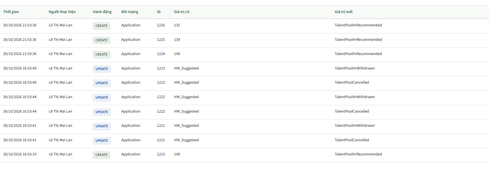
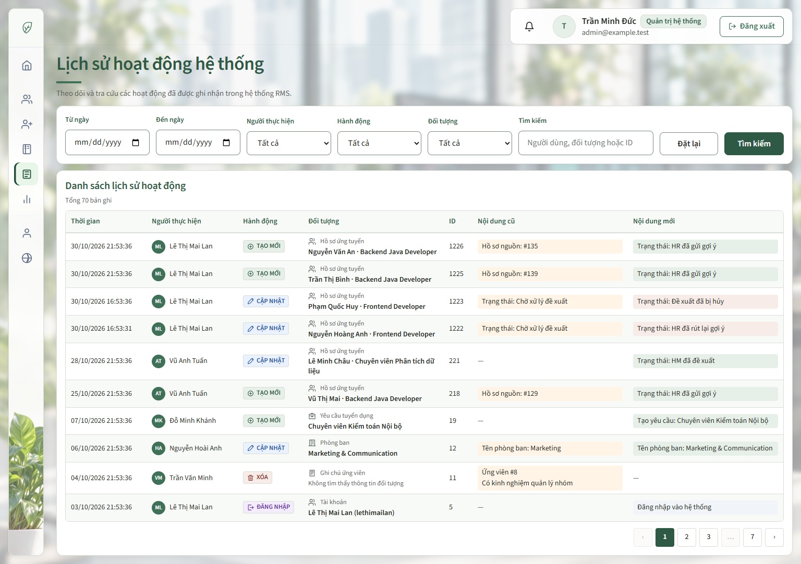
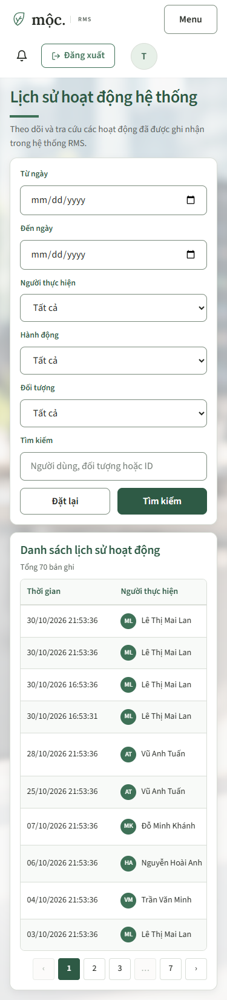
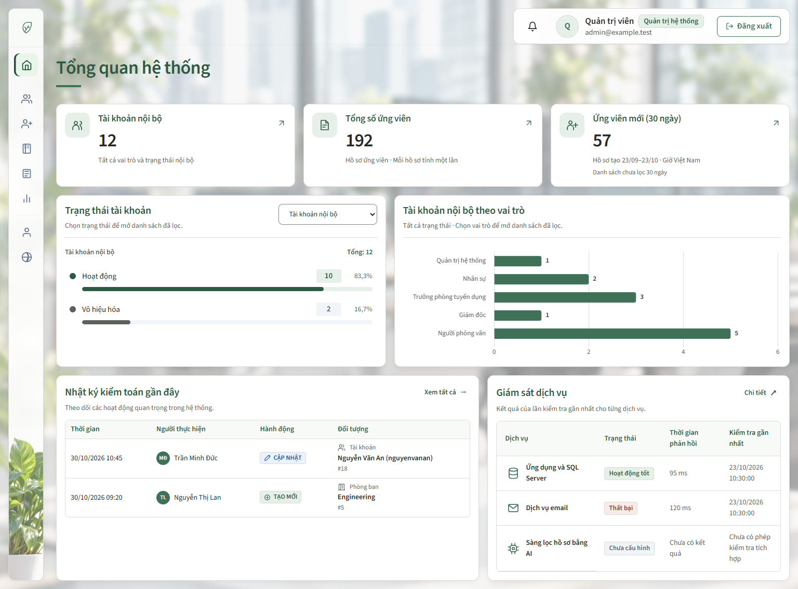

# Cập nhật trang Audit Log của Admin — 31/10/2026

**Trang chính:** `/admin/audit-logs`  
**Trang liên quan:** `/dashboard/admin`  
**Quyền truy cập:** Quản trị hệ thống (System Admin).

## 1. Mục tiêu và kết quả

Bổ sung trang tra cứu lịch sử hoạt động, sau đó chỉnh bảng theo mẫu người dùng cung cấp để dễ đọc hơn. Giao diện mới giải thích các mã kỹ thuật bằng tiếng Việt, phân biệt hành động bằng màu và icon, đồng thời giảm khoảng cách giữa các dòng.

- Tận dụng bảng `AuditLog` hiện có; không thay đổi schema DB.
- Giữ bộ lọc theo khoảng ngày, người thực hiện, hành động, đối tượng và từ khóa tìm kiếm.
- Giữ phân trang cố định **10 bản ghi/trang**, mới nhất trước; không có bộ chọn số dòng.
- Bỏ cột địa chỉ IP khỏi giao diện theo yêu cầu.
- Dashboard có bảng **5 hoạt động gần nhất** và liên kết **Xem tất cả**.
- Chỉ bổ sung ghi log trong các module người dùng phụ trách; giữ nguyên các luồng ghi log khác đã có.

## 2. Thay đổi để bảng dễ hiểu hơn

| Thành phần | Trước | Sau |
| --- | --- | --- |
| Hành động | `CREATE`, `UPDATE`, `DELETE`, `LOGIN` | Tạo mới, Cập nhật, Xóa, Đăng nhập; có icon và màu riêng |
| Đối tượng | `User`, `Department`, `Application`… | Loại đối tượng kèm tên cụ thể: tên ứng viên và tin ứng tuyển, tên yêu cầu, tin tuyển dụng, tài khoản hoặc phòng ban |
| Người thực hiện | Chỉ có họ tên | Họ tên kèm avatar chữ cái |
| Nội dung cũ/mới | Giá trị thô, nhiều mã khó hiểu | Nhãn tiếng Việt và nền màu nhẹ để phân biệt |
| Hồ sơ nguồn | Chỉ hiện số, ví dụ `135` | `Hồ sơ nguồn: #135` khi bản ghi tạo đề xuất có lưu ID hồ sơ nguồn |
| Mật độ bảng | Dòng cao, nhiều khoảng trắng | Khoảng cách gọn; sau bổ sung loại và tên đối tượng, dòng mẫu khoảng **53px** trên desktop. Nội dung dài vẫn xuống dòng để đọc đầy đủ |
| Màn hình nhỏ | Bảng nhiều cột | Bộ lọc xuống dòng; bảng cuộn ngang bên trong, không làm tràn ngang cả trang |

Một số mã đã được chuyển thành nội dung dễ đọc:

| Mã lưu trong DB | Nội dung hiển thị |
| --- | --- |
| `TalentPoolHrRecommended` | Trạng thái: HR đã gửi gợi ý |
| `TalentPoolSuggested` | Trạng thái: HM đã đề xuất |
| `TalentPoolHrWithdrawn` | Trạng thái: HR đã rút lại gợi ý |
| `TalentPoolCancelled` | Trạng thái: Đề xuất đã bị hủy |
| `HM_Suggested` | Trạng thái: Chờ xử lý đề xuất |
| `TalentPoolActivated` | Trạng thái: Đã xác nhận dùng CV cũ |
| `TalentPoolCandidateSubmitted` | Trạng thái: Ứng viên đã nộp CV mới |
| `TalentPoolMarked` / `TalentPoolUnmarked` | Tiềm năng: Đã đánh dấu / Đã bỏ đánh dấu |

Các nhãn này chỉ dùng khi hiển thị. Giá trị gốc, ID, số lượng và thứ tự bản ghi được giữ nguyên. Ghi chú tự do và giá trị chưa có ánh xạ vẫn giữ nguyên nội dung, tránh diễn giải sai. Hủy một đề xuất không được mô tả thành bỏ đánh dấu ứng viên tiềm năng.

### Tên cụ thể của đối tượng

- Hồ sơ ứng tuyển: **tên ứng viên · tên tin tuyển dụng**.
- Yêu cầu/tin tuyển dụng, phòng ban: tên tương ứng. Tài khoản: họ tên kèm username; ứng viên và ghi chú ứng viên: tên ứng viên liên quan.
- Lịch phỏng vấn: tên ứng viên, tin tuyển dụng và thời gian bắt đầu. Cấu hình hệ thống: mô tả hoặc khóa cấu hình, không đọc giá trị cấu hình để làm tên.
- Áp dụng cùng cách trình bày ở bảng log gần đây trên dashboard. Giữ ID để đối chiếu; đối tượng không còn dữ liệu hiện thông báo thay vì đoán tên.
- Tên được lấy từ **dữ liệu hiện tại**, không phải bản chụp tên ở thời điểm ghi log. Chỉ tra cứu theo các đối tượng trong trang, gom theo loại và loại bỏ ID trùng để tránh truy vấn riêng từng dòng; không đổi schema hoặc luồng ghi log.

## 3. Ảnh giao diện

**Nguồn ảnh:** ảnh trước cập nhật do người dùng cung cấp. Các ảnh sau cập nhật là HTML do MockMvc render bằng dữ liệu giả lập, được mở và chụp trong Chrome; không phải ảnh chụp dữ liệu DB thật. Số liệu và tên trong bản xem thử không xác nhận số liệu vận hành thực tế.

### Trước cập nhật

Các mã kỹ thuật được hiển thị trực tiếp, khó nhận biết ý nghĩa của hành động và trạng thái.

### Sau cập nhật — desktop

Bản xem thử có 10 dòng để kiểm tra bố cục, các nhóm hành động, đối tượng và nội dung cũ/mới.

### Sau cập nhật — mobile

Bộ lọc chuyển thành một cột ở màn hình nhỏ; người dùng cuộn ngang trong bảng để xem các cột còn lại.

### Bảng log gần đây trên dashboard

Áp dụng cùng cách Việt hóa hành động, đối tượng và avatar. Ảnh giả lập này có 2 dòng; chức năng thực tế truy vấn tối đa 5 bản ghi gần nhất.

## 4. Phạm vi ghi log

| Module của người dùng | Phạm vi đã thực hiện |
| --- | --- |
| Đăng ký | Ghi khi tài khoản được tạo thành công sau xác minh OTP |
| Reset mật khẩu | Ghi khi đặt lại mật khẩu thành công; không lưu mật khẩu, hash hoặc OTP vào nội dung log |
| Tài khoản | Tạo, sửa thông tin/vai trò/phòng ban và kích hoạt/vô hiệu hóa theo các thao tác hiện có |
| Phòng ban | Tạo, sửa tên/trưởng phòng, kích hoạt/vô hiệu hóa; ghi thay đổi vai trò liên quan khi chuyển trưởng phòng |
| Ứng viên tiềm năng | Giữ log đánh dấu/bỏ đánh dấu đã có; bổ sung log thêm, sửa và xóa ghi chú |

Không bổ sung chức năng xóa cứng tài khoản/phòng ban. Không bổ sung ghi log đăng nhập mới: nhãn **Đăng nhập** dùng để trình bày các bản ghi `LOGIN` đã có. Không thêm ghi log mới vào các module tuyển dụng của thành viên khác.

## 5. Kiểm tra và giới hạn bằng chứng

**Đợt bổ sung tên đối tượng:** 24 test liên quan đã qua, gồm kiểm tra gom ID trùng, đối tượng không còn dữ liệu, ID không hợp lệ và bảo toàn giá trị log. Thêm 2 test chỉ đọc trên SQL Server đã qua; đã thực thi truy vấn cho 9 loại đối tượng được hỗ trợ và đối chiếu tên ứng viên/tin ứng tuyển. Chrome desktop/mobile không tràn ngang toàn trang và không có lỗi JavaScript.

**Đợt chỉnh giao diện dễ đọc:** 18 test đã qua, không có lỗi hoặc test bị bỏ qua.

| Bộ test | Số test |
| --- | ---: |
| `AuditLogWebTests` | 6 |
| `AuditLogServiceTests` | 3 |
| `AuditLogLabelsTests` | 6 |
| `AdminDashboardViewTests` | 3 |
| **Tổng** | **18** |

- Kiểm tra bộ lọc giữ nguyên giá trị kỹ thuật khi gửi truy vấn dù nhãn hiển thị đã Việt hóa; liên kết phân trang giữ bộ lọc.
- Kiểm tra quyền Admin, trạng thái rỗng, khoảng ngày không hợp lệ và escape HTML trong nội dung log.
- Kiểm tra ánh xạ mã Talent Pool, hồ sơ nguồn, vai trò tài khoản; bảo toàn nội dung ghi chú và mã chưa biết.
- Chrome desktop **1536 × 960** và mobile **375 × 812**: không tràn ngang toàn trang, không có lỗi JavaScript. Bảng có 7 cột và cuộn ngang trên mobile.
- Ở đợt bổ sung chức năng trước đó, 255 test liên quan và 1 test truy vấn **chỉ đọc** trên SQL Server đã qua. Truy vấn tổng số log, người thực hiện và khoảng ngày khớp dữ liệu DB.
- Chưa kiểm thử E2E toàn bộ các luồng phát sinh log mới trên DB thật. Bộ test OTP cũ từng có 8 ca lệch kỳ vọng thời hạn 5/15 phút so với code hiện tại dùng 1 phút; không thay đổi logic OTP trong công việc này.

## 6. File chính

- `src/main/resources/templates/admin/audit-log.html`: bộ lọc, bảng, avatar, nhãn hành động và nội dung cũ/mới.
- `src/main/resources/static/css/pages/audit-log.css`: bảng gọn, màu, khoảng cách và responsive.
- `src/main/java/com/group2/rms/admin/dto/AuditLogLabels.java`: nhãn tiếng Việt và nội dung trình bày.
- `src/main/java/com/group2/rms/admin/service/AuditLogService.java`: truy vấn log và dữ liệu hiển thị.
- `src/main/java/com/group2/rms/admin/repository/AuditLogTargetRepository.java`: tra cứu tên đối tượng theo từng nhóm trên trang.
- `src/main/java/com/group2/rms/admin/controller/AuditLogController.java`: trang tra cứu và lựa chọn bộ lọc.
- `src/main/resources/templates/dashboard/admin.html`: bảng hoạt động gần đây.

Ảnh được lưu trong thư mục `assets/admin-audit-log-2026-10-31/` cạnh tài liệu. Khi chia sẻ hoặc di chuyển file Markdown, cần giữ kèm thư mục ảnh này để ảnh tiếp tục hiển thị.
