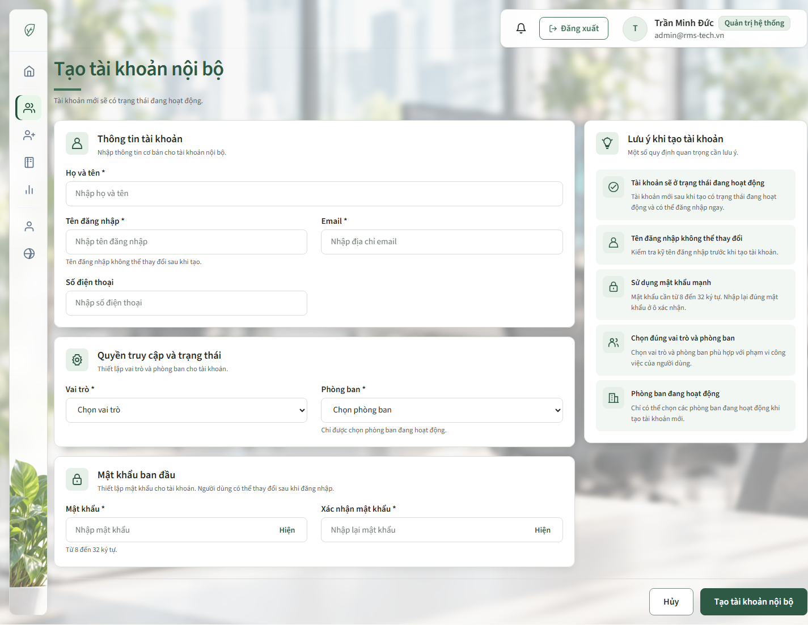
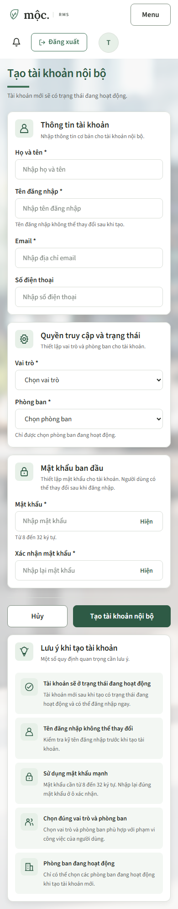
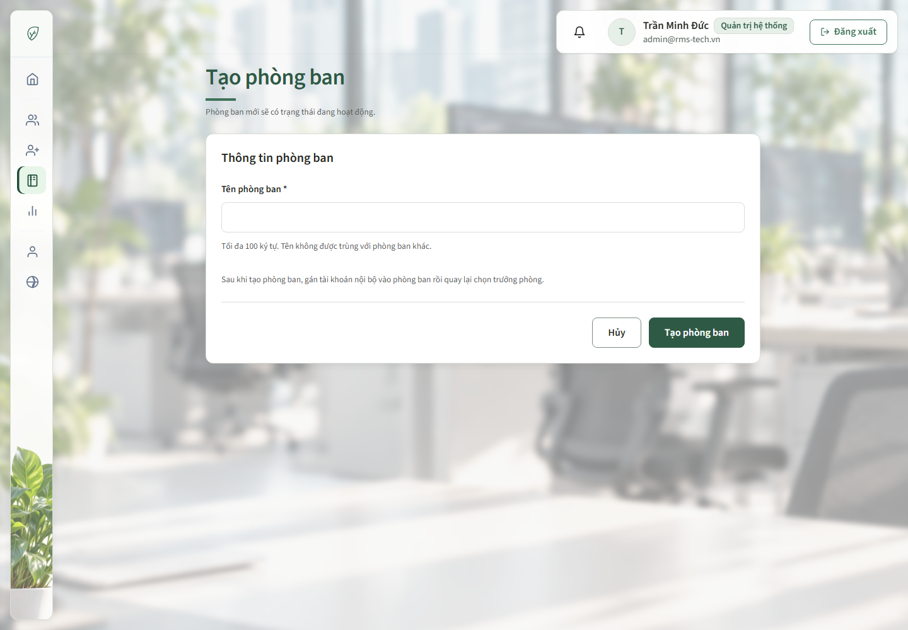
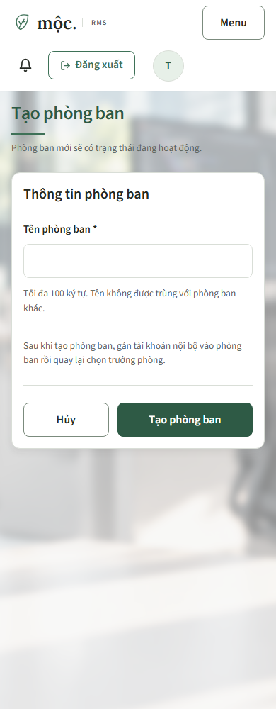

# 31/10/2026 — Giao diện tạo tài khoản và phòng ban

**Người thực hiện:** LinhDN. **Trang:** `/admin/accounts/new`, `/admin/departments/new`.

## Yêu cầu và kết quả

Áp dụng hai layout trong mockup, dùng giao diện Mộc và giữ sidebar/topbar của các trang nội bộ.

- Tạo tài khoản: ba thẻ bên trái gồm Thông tin tài khoản, Quyền truy cập và trạng thái, Mật khẩu ban đầu; cột phải là năm lưu ý khi tạo tài khoản. Hủy/Tạo tài khoản nội bộ nằm cuối form, căn phải.
- Họ tên chiếm một hàng; username/email và role/phòng ban chia hai cột trên desktop. Điện thoại giữ ở cột trái; hai ô mật khẩu cùng hàng, giữ nút hiện/ẩn hiện có.
- Tạo phòng ban: một thẻ tối đa 880px, chỉ có trường tên, hướng dẫn giới hạn/không trùng tên và phân công trưởng phòng sau khi tạo. Không thêm trường chọn trưởng phòng ở chế độ tạo.
- Tablet/mobile chuyển form tài khoản thành một cột; nút Hủy/Tạo nằm ngay sau các trường nhập, trước phần lưu ý dài. Hai trang không tràn ngang ở 320px và 390px.
- CSS riêng `admin-create-forms.css`, tiền tố `acf-`, chỉ nạp cho tạo mới. Các wrapper bố cục tài khoản được bỏ khỏi DOM khi sửa; hai màn sửa vẫn dùng CSS và bố cục trước đó.
- Giữ nguyên POST action, Thymeleaf binding, CSRF, required/maxlength, validation summary và lỗi tại trường. Tạo tài khoản vẫn mặc định Active, chỉ chọn phòng đang hoạt động; không thêm ô trạng thái. Không đổi controller/service hoặc JavaScript dùng chung.

## Ảnh giao diện

Ảnh Chrome từ HTML do MockMvc render với dữ liệu fixture. Đây là kiểm chứng giao diện local, không phải ảnh từ tài khoản/database thật; browser QA không gửi POST lưu dữ liệu.

### Tạo tài khoản — desktop

### Tạo tài khoản — mobile

### Tạo phòng ban — desktop

### Tạo phòng ban — mobile

## Bốn skill và quyết định thiết kế

- Theo hợp đồng Mộc/UI Rules trước: dùng lại palette, font, token, nút và khung workspace; chỉ thay phần nội dung trang.
- UI UX Pro Max: chia nhóm trường, giữ nhãn/hướng dẫn/lỗi tại trường, thao tác bàn phím và responsive.
- Impeccable: phân cấp tiêu đề, nhịp khoảng cách, kiểm tra trạng thái lỗi và màn sửa dùng chung template.
- Taste: `accent-ladder`, seed **782013712**, giữ palette/type. Câu hỏi của trang là cần nhập những gì để tạo tài khoản hợp lệ hoặc tạo một phòng ban mới. Dữ liệu gồm một form tài khoản có thông tin/quyền/mật khẩu, hoặc một tên phòng ban; không thêm số liệu giả.
- Awesome Design Reference: tham khảo Hierarchy trong `.agents/references/awesome-design-md/upstream/design-md/sap/DESIGN.md`, chỉ lấy cách phân nhóm thông tin; mockup người dùng quyết định bố cục cuối.
- Sau render: các thẻ form độc lập, cột lưu ý không bị kéo cao theo tổng ba thẻ; phòng ban giữ một khung gọn. Mobile ưu tiên hoàn tất nhập và submit trước phần giải thích.

## Thống kê file

Tính so với snapshot đầu lượt, không gộp các thay đổi màn sửa đã có trước.

<!-- file-stats:start -->
| File | Thêm | Xóa |
| --- | ---: | ---: |
| `src/main/resources/templates/admin/accounts/form.html` | +30 | -15 |
| `src/main/resources/templates/admin/departments/form.html` | +8 | -7 |
| `src/main/resources/static/css/pages/admin-create-forms.css` | +57 | -0 |
| `src/test/java/com/group2/rms/user/controller/AccountEditWebTests.java` | +2 | -2 |
| `src/test/java/com/group2/rms/user/controller/DepartmentEditWebTests.java` | +2 | -2 |
| `src/test/java/com/group2/rms/user/controller/AdminCreateFormsWebTests.java` | +155 | -0 |
| `docs/management/WORK_LOG.md` | +1 | -0 |
| `docs/members/linhdn/README.md` | +2 | -0 |
| `docs/members/linhdn/2026-10-31-admin-create-forms-ui.md` | +86 | -0 |
| `docs/members/linhdn/assets/admin-create-forms-2026-10-31/account-desktop.png` | Ảnh mới (460,585 byte) | — |
| `docs/members/linhdn/assets/admin-create-forms-2026-10-31/account-mobile.png` | Ảnh mới (182,358 byte) | — |
| `docs/members/linhdn/assets/admin-create-forms-2026-10-31/department-desktop.png` | Ảnh mới (596,483 byte) | — |
| `docs/members/linhdn/assets/admin-create-forms-2026-10-31/department-mobile.png` | Ảnh mới (109,913 byte) | — |
| **Tổng 13 file (9 text, 4 ảnh)** | **+343 dòng** | **-26 dòng** |
<!-- file-stats:end -->

## Kiểm chứng và giới hạn

- **17 kiểm thử MVC qua:** AdminCreateFormsWebTests 7/7, AccountEditWebTests 7/7, DepartmentEditWebTests 3/3. Hai suite cũ chỉ đổi assertion về stylesheet của chế độ tạo; các ca sửa vẫn qua.
- Bao gồm render cả hai form tạo, dữ liệu/validation lỗi, xóa hai mật khẩu khỏi bản render khi submit lỗi, command/redirect hiện có, chặn HR/anonymous và POST thiếu CSRF. Service/repository được mock; không coi đây là bằng chứng ghi SQL Server thật.
- Lượt đầu có một assertion sai về câu lỗi tên phòng ban do localization hiện có; đã đổi assertion kiểm tra lỗi thực sự tại trường, chạy lại cả suite tạo mới và đạt 7/7. Không thay thông báo validation của sản phẩm.
- Chrome: desktop 1440px, tablet 768px, mobile 390px/320px; ba thẻ tài khoản, năm lưu ý, trường chia cột, action trước lưu ý trên màn nhỏ, giới hạn tên phòng ban và lỗi tại trường đều được kiểm tra. Không có JavaScript exception.
- Click hiện/ẩn mật khẩu và Tab thật từ họ tên sang username: type/aria-pressed và focus-visible đúng. Kiểm tra cả form lỗi và giá trị nhập dài; không lưu dữ liệu qua browser fixture.
- Hai trang sửa không nạp CSS tạo mới; tài khoản không có wrapper/lưu ý/mật khẩu của tạo mới. Thẻ sửa tài khoản tại 1440px vẫn rộng 1280px, cao 777,5px; sửa phòng ban giữ dải tổng quan và trường trưởng phòng.
- Taste source lint: **0 FAIL, 0 WARN**. Browser inspector: **0 FAIL**, tài khoản 4 WARN, phòng ban 3 WARN. Giữ nền sáng ấm, font stack/fallback và h1 desktop 36px theo hệ Mộc dùng chung; không sửa token/font/shell ngoài phạm vi. Chênh chiều cao cột form/lưu ý là bố cục có chủ đích theo mockup, không kéo giãn thẻ lưu ý. Các cảnh báo browser này vẫn được ghi nhận, không bị ẩn.
- Ảnh đã được xem lại ở desktop/mobile. Kiểm chứng local chưa bao gồm phiên đăng nhập thật, lưu database hoặc triển khai production.
- Không có migration/schema/seed, không commit/push. Đối chiếu hash và hợp đồng form để kiểm tra không thay file ngoài phạm vi; kết quả tổng hợp bên dưới.

Đối chiếu cuối: SHA-256 của **965 file đã theo dõi ngoài phạm vi** giữ nguyên; chỉ 6 file đã có thay đổi đúng danh sách. Các `th:action` và `th:field` trong cả hai template khớp snapshot đầu lượt.

## Rà soát hook sau bàn giao

- `flat-type-hierarchy` ở template tài khoản là false positive: detector đọc file riêng lẻ báo body/h1/h2 đều 16px, trong khi Chrome với CSS liên kết đo h1 36px desktop/26px mobile, tiêu đề nhóm 18px và input 15px. CSS sửa tài khoản cũng có tiêu đề nhóm 20px, mobile h1 24px. Có bước phân cấp lớn hơn 1,25 lần; ảnh đã lưu thể hiện đúng.
- Đã dùng `impeccable hooks ignore-value flat-type-hierarchy "*" --file src/main/resources/templates/admin/accounts/form.html` với lý do và đường dẫn bằng chứng. Ngoại lệ chỉ áp dụng đúng rule/file này trong `.impeccable/config.json` (file cấu hình đang được Git bỏ qua); không tắt hook hoặc các rule khác.
- Chạy lại detector cho template: không còn finding. Không thay UI/source/ảnh trong lượt rà soát này; các WARN browser phía trên vẫn giữ nguyên, không có lỗi thiết kế mới cần sửa.
