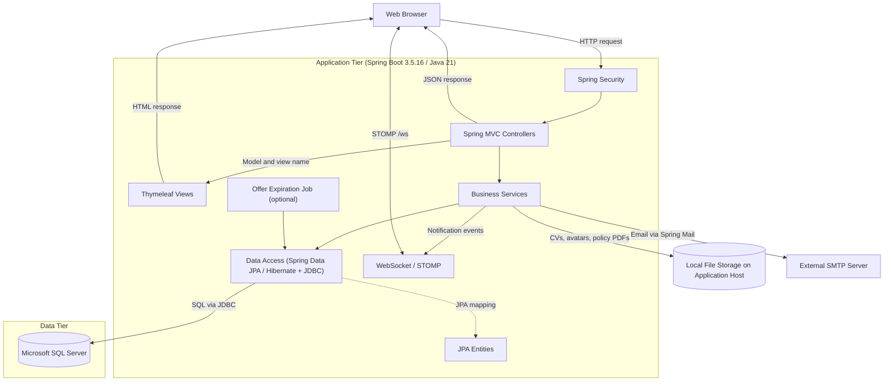

# Đối chiếu sơ đồ kiến trúc hệ thống RMS

Đối chiếu ảnh *Software Architecture* với mã nguồn nhánh `feature/update-ui-authen` tại `ca8f1779` ngày 08/11/2026. Kiểm tra tĩnh mã nguồn và cấu hình trong repo.

## Kết quả

Sơ đồ khớp mô hình web ba tầng. Client là trình duyệt, Application Tier là một ứng dụng Spring Boot tổ chức theo module nghiệp vụ, và SQL Server lưu dữ liệu quan hệ. Controller, Service và Repository là các lớp logic trong cùng ứng dụng.

| Thành phần trong ảnh | Hiện trạng và cách thể hiện |
| --- | --- |
| Application Tier | Đổi `Spring Boot 4.2 / Java 21` thành `Spring Boot 3.5.16 / Java 21` theo [pom.xml](../../../pom.xml#L7). |
| HTTP, Spring Security, Controller và View | Giữ luồng request qua Spring Security đến Spring MVC. Với trang HTML, controller cung cấp model và tên view, Thymeleaf render HTML để trình duyệt hiển thị. Một số endpoint trả JSON, ví dụ [NotificationApiController](../../../src/main/java/com/group2/rms/notification/controller/NotificationApiController.java#L28). |
| Cloudinary | Thay bằng `Local File Storage` trên máy chủ ứng dụng. [LocalCvStorage](../../../src/main/java/com/group2/rms/candidate/infra/cv/LocalCvStorage.java#L24), [LocalAvatarStorage](../../../src/main/java/com/group2/rms/user/service/LocalAvatarStorage.java#L25) và [PolicyDocumentStorage](../../../src/main/java/com/group2/rms/admin/service/PolicyDocumentStorage.java#L27) lưu CV, ảnh đại diện và PDF chính sách đã tải lên tại `app.storage.local-root`, mặc định `uploads`. |
| SMTP / Mail Server | Giữ tích hợp. Ứng dụng dùng Spring Mail để gửi email. [Cấu hình trong repo](../../../src/main/resources/application.properties#L54) đặt SMTP Gmail. |
| Compliance Scheduler | Bỏ khỏi sơ đồ hiện trạng. Job định kỳ tìm thấy là [OfferExpirationJob](../../../src/main/java/com/group2/rms/offer/service/OfferExpirationJob.java#L22), cập nhật Offer quá hạn qua repository khi bật `app.offer.expiration.enabled=true`. Job tắt mặc định. |
| Repository, JPA Entities và SQL Server | Đặt `Spring Data JPA / Hibernate` phía ứng dụng. Data Tier ghi `Microsoft SQL Server`. Bổ sung JDBC trong lớp truy cập dữ liệu vì một số luồng gọi `JdbcTemplate` trực tiếp, ví dụ [UserAuditLogger](../../../src/main/java/com/group2/rms/user/service/UserAuditLogger.java#L20). |
| Kênh realtime | Nếu sơ đồ bao quát các kênh giao tiếp với trình duyệt, bổ sung WebSocket/STOMP `/ws` để đẩy thông báo. Broker nằm trong ứng dụng theo [WebSocketConfig](../../../src/main/java/com/group2/rms/core/config/WebSocketConfig.java#L20). |

## Xác nhận bản ảnh cập nhật

Bản mới đã ghi đúng `Spring Boot 3.5.16 / Java 21`, thay Cloudinary bằng `Local File Storage` và bỏ `Compliance Scheduler`. Luồng MVC trả HTML, tích hợp SMTP và SQL Server khớp với mã nguồn tại `ca8f1779`.

Hai điểm cần chỉnh để thể hiện đúng ranh giới hệ thống và vị trí công nghệ:

1. Đưa `Local File Storage` ra khỏi `External Services`. Đặt trong vùng máy chủ ứng dụng hoặc ghi rõ `Application Host Filesystem (uploads/)`. Nhãn luồng có thể là `Read/write CVs, avatars and policy PDFs` để bao quát phạm vi lưu tệp.
2. Đặt `Spring Data JPA / Hibernate` ở lớp truy cập dữ liệu bên Application Tier. Data Tier chỉ cần ghi `Microsoft SQL Server`. Dùng `Data Access (Spring Data JPA / Hibernate + JDBC)` và mũi tên `SQL via JDBC` để thể hiện cả truy vấn ORM lẫn các luồng `JdbcTemplate`.

Có thể bổ sung `HTTP/JSON` và `WebSocket/STOMP /ws` nếu sơ đồ cần mô tả đầy đủ các kênh giao tiếp của trình duyệt. `Offer Expiration Job` là thành phần tùy chọn theo cấu hình và tắt mặc định.

## Sơ đồ hiện trạng đề xuất

Việc gửi email, kết nối SQL Server, bật job và nhận thông báo qua WebSocket cần được kiểm chứng riêng trên môi trường triển khai.
